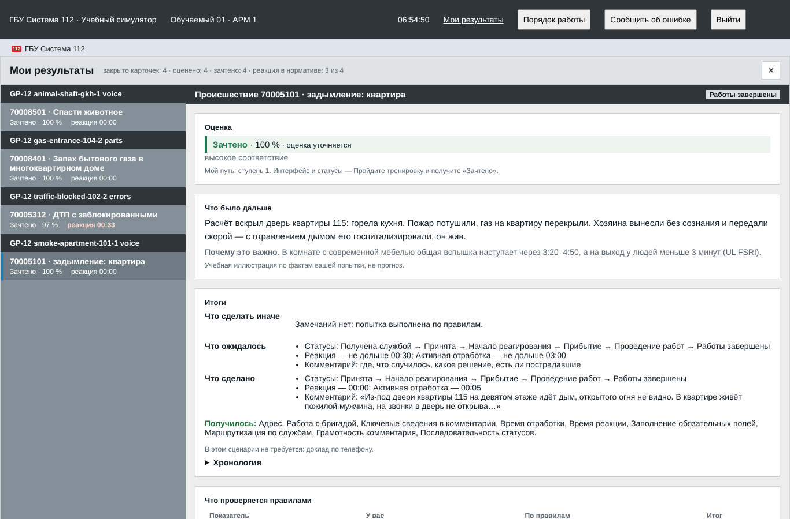
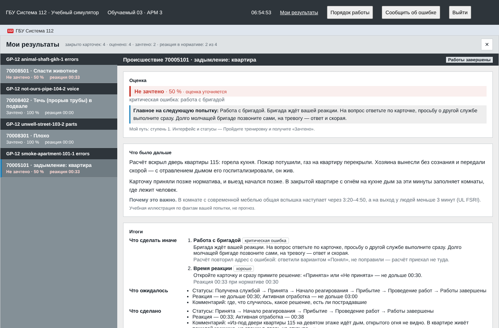
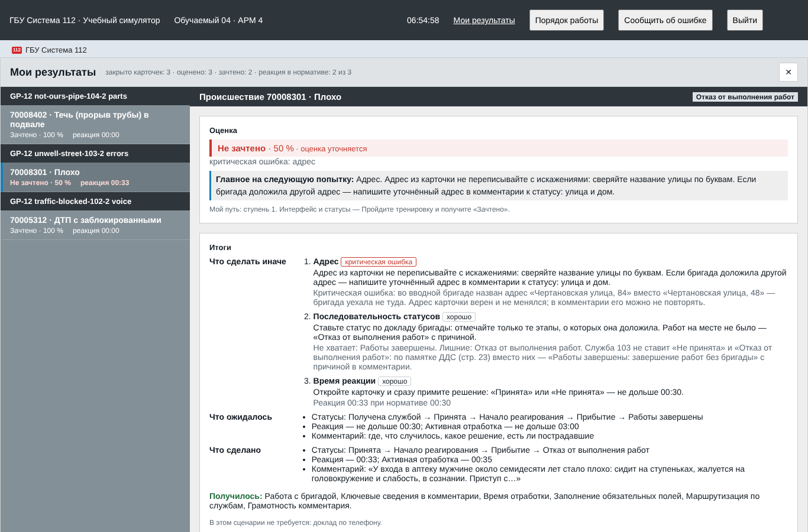
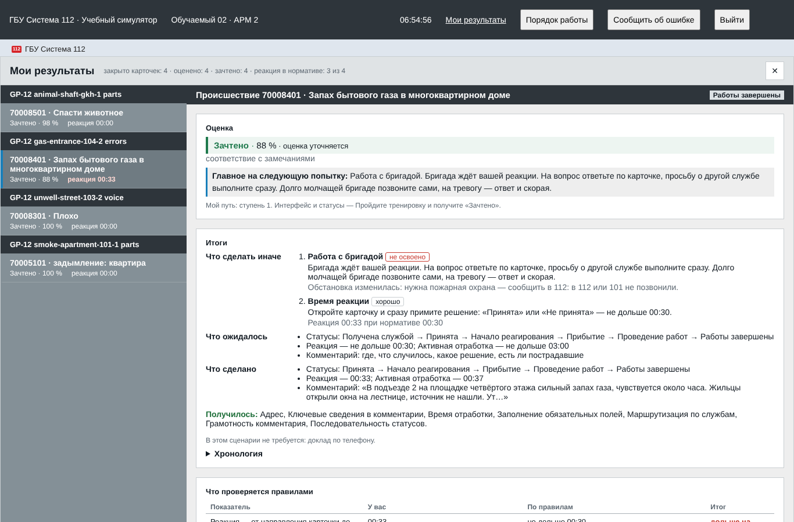
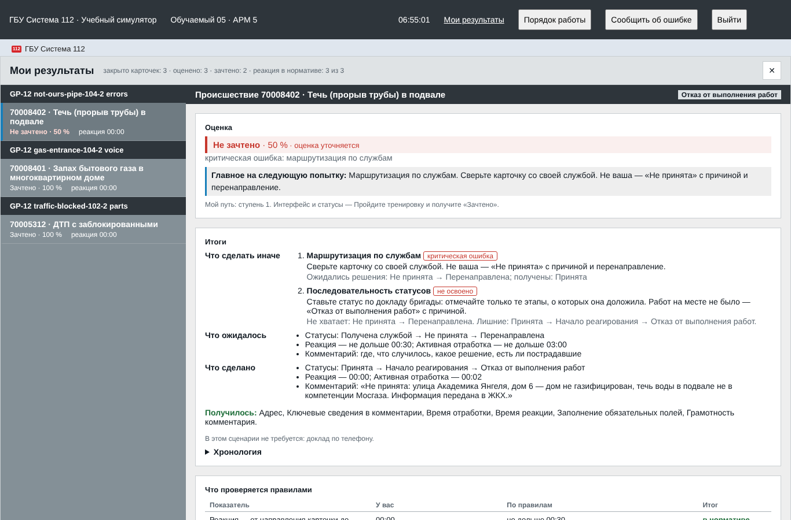

# Сверка стенда с эталоном игрового процесса ДДС (GP-12)

Проверка по `docs/dds_gameplay.md`, раздел 10: каждый сценарий раздела 8 пройден на стенде
трижды — голосом, по частям и с ошибками раздела 7. Карточка закрывается, разбор совпадает с
допущенными ошибками, ни одного ожидания доклада дольше 40 с. Дата — 17.10.2026, ветка
`feature/dds-gameplay`.

## Стенд и способ проверки

- **Стенд.** Docker-стенд (`scripts/stand/up.sh --project arm112-ralph-gp --ports 46080:46443
  --stt local`) в облачной сессии не собрался: прокси не пускает к хранилищу образов ghcr.io
  (`ghcr.io/astral-sh/uv:0.8.22`, ответ 403 на `pkg-containers.githubusercontent.com`), а пакеты
  deb.debian.org и dl-cdn.alpinelinux.org закрыты. Проверка шла на стенде без Docker: локальный
  PostgreSQL, API в режиме `database`, worker (такт 0,5 с) и веб (vite), чистая база, seed и все
  37 сценариев. Распознавание речи на этом стенде выключено (`STT_PROVIDER=off`).
- **Прохождение** — скрипт `qa/smoke/dds_walk.py`: говорит со стендом только через HTTP API,
  как окно телефона ДДС. Преподаватель выдаёт сценарий и начинает занятие; обучаемый получает
  карточку, ставит «Принята», звонит свободной бригаде с вводной, отвечает на её входящие вызовы
  (каждый разговор — отдельный звонок, через 6 с тишины отбой, раздел 4), подтверждает доклад
  («Принял»), ставит статус по докладу, звонит в службы по просьбе бригады, на тревогу и
  заявителю, долго молчащей бригаде звонит сам («Доложите обстановку»), закрывает карточку и
  читает разбор. 18 прогонов идут параллельно за пятью обучаемыми, около 4 минут.
- **Ожидание доклада** — время от последнего действия обучаемого или реплики бригады до
  следующей реплики бригады (начала её вызова). Порог — 40 с (раздел 1, п. 5).
- **Пути.** «Голосом» — вводная, ответы бригаде и доклад службе отправлены как голосовые
  (`mode: voice`, доклад службе — `voice-report` с текстом фразы: распознанный текст подставлен
  вместо распознавания). Отдельно проверено, что WAV вводной доходит до распознавания: стенд
  отвечает `503 stt_off` «Распознавание речи выключено на сервере». «По частям» — вводная
  частями, ответы вариантами, доклад службе вариантом. «С ошибками» — ошибки раздела 7: «Принята»
  через 33 с (норматив 30 с), статус «Прибытие» сразу после выезда, без доклада, и ветка ошибки
  сценария (`data/scenarios/README.md`, «Набор на финал»).

Повторить: поднять стенд и выполнить

```
uv run --package arm112-scripts python qa/smoke/dds_walk.py \
    --api http://127.0.0.1:8000/api --password demo-local --wav --out walk.json
```

Код выхода 0 — все прогоны сошлись с эталоном. Только часть прогонов —
`--only smoke-apartment-101-1 gas-entrance-104-2:errors`.

## Итог: сценарий × путь

Столбец «Ожидание» — самое долгое ожидание доклада за прогон, с. Баллы — критерии разбора ниже
1 (остальные равны 1), «крит.» — критическая ошибка.

| Сценарий | Путь | Допущенные ошибки | Ожидание, с | Закрыта | Разбор | Итог |
|---|---|---|---|---|---|---|
| 101 `smoke-apartment-101-1` | голосом | — (на 20-й секунде молчания бригады — звонок «Доложите обстановку») | 21,3 | да | все 1 | совпадает |
| 101 | по частям | — (вводная преподавателя «Тревога»: ответ и вызов 103) | 15,7 | да | все 1 | совпадает |
| 101 | с ошибками | «Принята» через 33 с; «Прибытие» без доклада — отказ 409; повтор адреса не поправлен («Понял») | 31,9 | да | brigade_work 0,75 · крит.; reaction_time 0,89 | совпадает |
| 102 `traffic-blocked-102-2` | голосом | — | 5,4 | да | все 1 | совпадает |
| 102 | по частям | — | 4,1 | да | все 1 | совпадает |
| 102 | с ошибками | «Принята» через 33 с; «Прибытие» без доклада — отказ 409; «Работы завершены» вместо «Отказ от выполнения работ» | 4,5 | да | status_flow 0,80; reaction_time 0,90 | совпадает |
| 103 `unwell-street-103-2` | голосом | — | 4,4 | да | все 1 | совпадает |
| 103 | по частям | — | 6,3 | да | все 1 | совпадает |
| 103 | с ошибками | «Принята» через 33 с; во вводной дом 84 вместо 48; «Прибытие» без доклада — отказ 409; «Отказ от выполнения работ» у скорой | 31,0 | да | address 0 · крит.; status_flow 0,80; reaction_time 0,90 | совпадает |
| 104 `gas-entrance-104-2` | голосом | — (звонок в 112 об изменении обстановки) | 8,3 | да | все 1 | совпадает |
| 104 | по частям | — | 9,5 | да | все 1 | совпадает |
| 104 | с ошибками | «Принята» через 33 с; «Прибытие» без доклада — отказ 409; в 112 не позвонили | 22,4 | да | brigade_work 0; reaction_time 0,90 | совпадает |
| любая `not-ours-pipe-104-2` | голосом | — («Не принята» с причиной, перенаправление в ЖКХ) | 0 | да | все 1 | совпадает |
| любая | по частям | — | 0 | да | все 1 | совпадает |
| любая | с ошибками | не нашу карточку приняли; «Прибытие» без доклада — отказ 409 | 0,4 | да | routing 0 · крит.; status_flow 0,25 | совпадает |
| ЖКХ `animal-shaft-gkh-1` | голосом | — (звонок заявителю 458 по телефону ДДС) | 3,9 | да | все 1 | совпадает |
| ЖКХ | по частям | — | 4,3 | да | call 0,83 | совпадает¹ |
| ЖКХ | с ошибками | «Принята» через 33 с; «Прибытие» без доклада — отказ 409; заявителя нет в телефоне ДДС — звонок 422 | 4,1 | да | call 0 · крит.; reaction_time 0,90 | совпадает |

¹ Доклад заявителю вариантом оценивается ниже доклада голосом (`report_choice_factor` 0,5,
решение #78, `docs/dds_stage_check.md`, п. 14): «Звонок по эталону, но доклад сделан вариантом
ответа». Так и задумано.

Все 18 карточек закрылись, разбор появился у каждой. Самое долгое ожидание доклада за все
прогоны — 31,9 с (98 реплик бригад). У «не нашей» карточки status_flow ниже 1 — следствие той
же ошибки маршрутизации (ход статусов «Принята → Начало реагирования → Отказ» вместо «Не
принята → Перенаправлена»).

## Снимки разбора

Разборы карточек этих прогонов на экране «Мои результаты» (веб стенда, 1366×900).

| Прогон | Снимок |
|---|---|
| 101 голосом — «Зачтено · 100 %» |  |
| 101 с ошибками — повтор адреса не поправлен, «Принята» поздно |  |
| 103 с ошибками — неверный дом во вводной, «Отказ» у скорой |  |
| 104 с ошибками — в 112 не позвонили |  |
| Не наша карточка принята |  |

## Что расходилось с эталоном и что сделано

| # | Расхождение | Раздел эталона | Что сделано |
|---|---|---|---|
| 1 | После ошибки обучаемый ждал доклада дольше 40 с: неисправленный повтор адреса — 78,7 с, бригада без звонка «Доложите обстановку» — 135,4 с, без звонка в 112 — 53,7 с. Задержки веток (`delay` 45–60 с) и сроки событий (`within_s` 40–60 с) не укладывались в паузу | 1, п. 5; 10 | Исправлено. Задержка ветки и неверного адреса во вводной не отодвигает доклад дальше 40 с от начала его ожидания (`gating.MAX_REPORT_WAIT`, `delayed`); сроки событий набора на финал — в бюджет 40 с, новые версии файлов (101 v6, 102 v6, 103 v4, 104 v4, ЖКХ v3: `within_s` 30, у молчания бригады 20 + 10 с). Проверка всех файлов — `apps/api/tests/test_report_wait_budget.py`; контракт — `contracts/scenario-events.md`, «Пауза между докладами» |
| 2 | Статус этапа, о котором бригада в сценарии не докладывает, сервер принимал: «Прибытие» у «не нашей» карточки — 200 | 3; 7 «Статус без доклада» | Исправлено: такой этап (нет доклада в плане и нет в эталоне хода статусов) всегда в `missing_report_states`, статус — 409 `report_required` «бригада о таком этапе не докладывала» (`status_evidence.py`, тест в `test_final_scenarios.py`) |
| 3 | Отказ сервера в статусе без доклада не попадает в разбор: в разделе 7 строка «Последовательность статусов», а попытка нигде не записана | 7 | Исправлено (GP-26): отказ 409 `report_required` пишется в журнал карточки записью `status_denied` (видна в ленте реплея преподавателя: «Статус не принят: Прибытие»); разбор называет её строкой «Последовательности статусов» «Не принят сервером: «Прибытие» — не было доклада бригады о прибытии», балл не снижается (раздел 7: «не критично»). АРМ отправляет такую попытку на сервер, хотя причину показывает сразу. `dds_walk.py` (путь errors) проверяет запись и строку: 6 из 6 ok |
| 4 | «Что было дальше» у 101 рассказывает чужой исход: «горела кухня… газ на квартиру перекрыли», а в сценарии горит проводка за шкафом. Исход берётся по номеру карточки из `data/practice` (`outcomes.json`), у сценариев 103, 104 и ЖКХ набора его нет вовсе | 1, п. 1 «свой исход» | Исправлено в GP-27: исход — блок `outcome` в файле сценария (`contracts/scenario-file.schema.json`, `ScenarioOutcome`), у шести сценариев набора свой (101 — проводка за шкафом), API отдаёт его с `CardTraining` после закрытия карточки, разбор показывает его вместо копии по номеру; у старых сценариев без блока — исход `data/practice`, как раньше |
| 5 | Голос с настоящим WAV не проверен: на стенде без Docker распознавание выключено, Docker-стенд не собрался | 6; 10 | Прогнать локально (ниже) |

## Что не проверено и как проверить локально

- **Голос с распознаванием.** На Docker-стенде с `--stt local` прогнать `qa/smoke/dds_walk.py
  --wav` (WAV вводной — тон 0,5 с — должен дойти до распознавания: ответ 200, а не 503
  `stt_off`) и e2e голосового пути `qa/e2e/dds-push-to-talk.spec.ts`, затем пройти 101 голосом в
  браузере.
- **Интерфейс по шагам.** Скрипт проходит сценарии через API, как окно телефона; сам интерфейс
  обучаемого проверяют e2e-спеки (`dds-phone`, `brigade-incoming`, `brigade-missed-hold`,
  `live-brigade`, `heard-status`, `live-shift`). На этом стенде вид «Мои результаты» снят
  снимками выше.
- **Docker-стенд** — `scripts/stand/up.sh --project arm112-ralph-gp --ports 46080:46443 --stt
  local`, затем тот же скрипт с `--api https://127.0.0.1:46443/api`, `--ca` — корневой
  сертификат стенда (`ca.crt` из тома сертификатов проекта, `deploy/certs`) и паролем из
  `scripts/stand/.local/arm112-ralph-gp/stand.env`.


---

## История проверки до обновления gameplay

Следующий протокол описывает предыдущую infra-версию и не заменяет актуальную сверку выше.

# Проверка геймплея ДДС: запуск с нуля (GP-17)

Дата: 16.10.2026. Источник — созвон с организаторами 16.10 («не запускается — худшее решение»).

## Запуск на чистой машине

Свежий клон репозитория (`git clone` в пустой каталог), новый проект Docker без своих образов,
томов и секретов:

```sh
scripts/stand/up.sh --project arm112-ralph-clean --ports 47080:47443 --stt local
```

| Шаг | Что происходит |
|---|---|
| сборка образов | api, web, stt (модель распознавания речи кладётся в образ) |
| запуск базы, миграции | Alembic до последней ревизии |
| seed, seed.training | справочники, сценарии ДДС, бригады и озвученные доклады |
| запуск api, worker, web, stt | ожидание `/api/health` = ok |

Итог: код выхода 0, стенд готов за **2 мин 34 с** (MacBook, 4 CPU, Docker 8 ГБ, интернет есть).
Оговорка: у образов этого проекта кэша не было, но слои с тем же содержимым (python, uv-зависимости,
pnpm) лежали в общем кэше Docker с соседних стендов — на совсем пустом Docker сборка дольше
(скачивание базовых образов, зависимостей и модели STT), порядок — 10–15 минут на хорошей сети.
Это время не измерено.

## Что проверено на поднятом стенде

Playwright (chromium) против `https://127.0.0.1:47443`: вход учётных записей, путь преподавателя
(`teacher-path`), тренировка ДДС со своей службой (`practice-scenarios`), общий номер 102 без
микрофона (`service-reply`), голосовой доклад бригады — звонок, звук, подтверждённое
предъявление (`brigade-audio`). Все четыре зелёные. Стенд после проверки остановлен (`stop`).

## Что нашлось и исправлено

- Вход в тренировку в тестах ждал выбор роли «Диспетчер служб», которого нет при выключенном
  модуле «Оператор 112» (GP-20): на чистом стенде модуль выключен, обучаемого встречает
  «Добро пожаловать». Проверки входа в `qa/e2e` приведены к этому; сам стенд работал.
- Сборка зависела от одного скачивания без запаса: добавлены `UV_HTTP_TIMEOUT=180`
  (`apps/api/Dockerfile`), `PIP_DEFAULT_TIMEOUT`/`PIP_RETRIES` (`deploy/stt/Dockerfile`) и
  до трёх попыток сборки в `up.sh` (`BUILD_ATTEMPTS`). Готовые слои берутся из кэша, повтор
  продолжает с места обрыва.

## Повтор при обрыве

Цикл `build_with_retry` проверен с подставной командой: первая попытка падает, вторая проходит
(код 0); при исчерпании попыток — код 1 и шаг «сборка образов» сообщает об ошибке. Настоящий
обрыв сети на сборке не воспроизводился.
