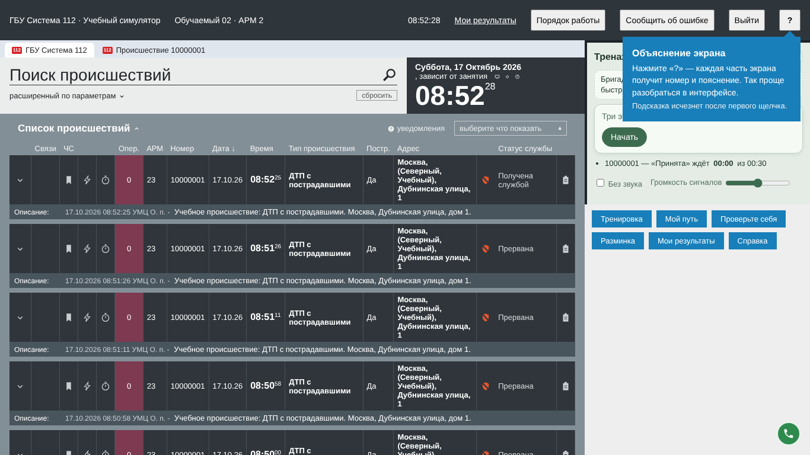
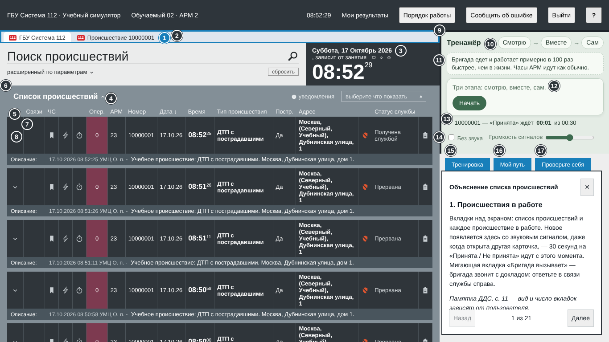
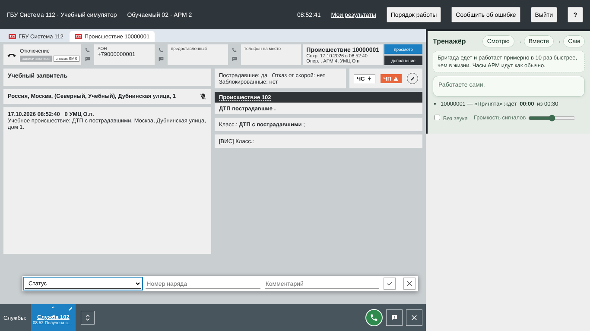
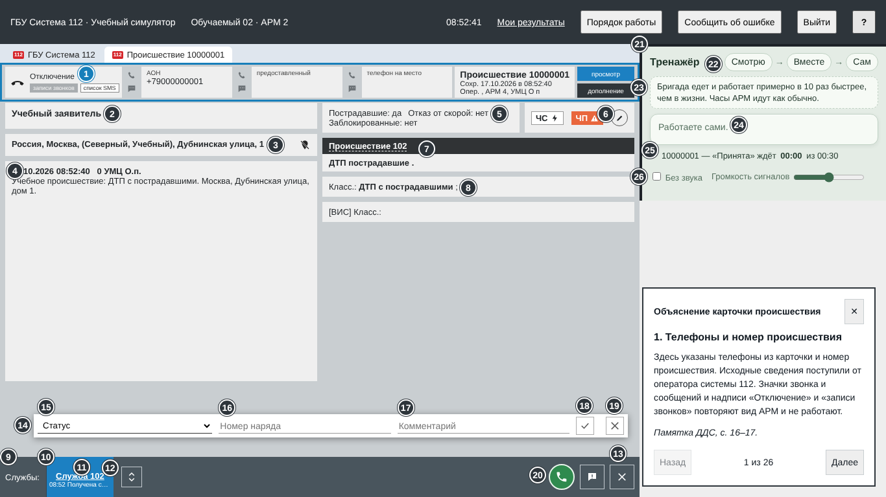
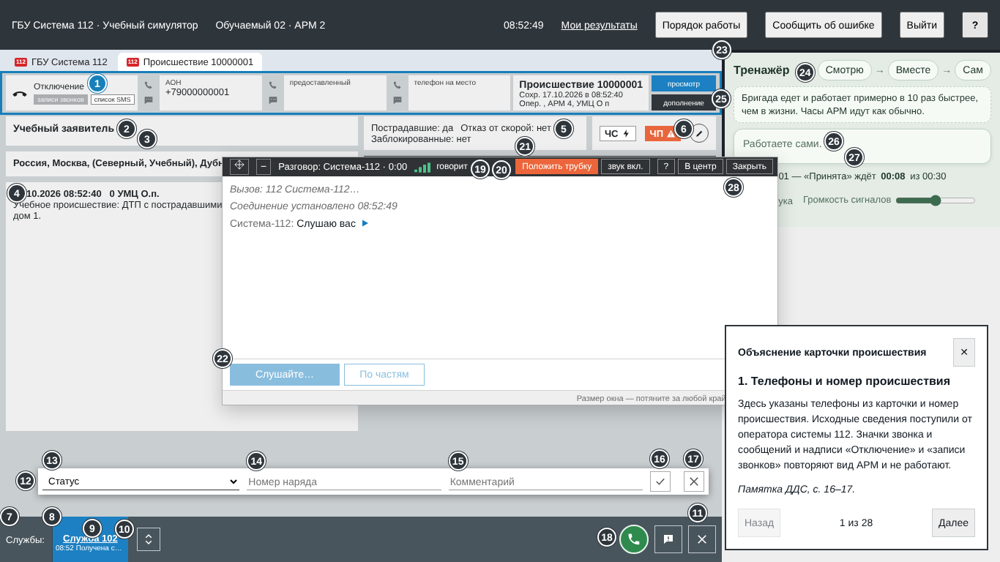

# Подсказки по интерфейсу ДДС для самостоятельного знакомства (GP-23)

Рекомендация 7 организаторов от 16.10 (`docs/meetings/2026-10-16_recommendations.md`):
подсказки о назначении окон и кнопок. Вид интерфейса обучаемого не меняется (рекомендация 6):
подсказки включаются поверх экрана и выключаются, без них экран тот же, что на снимках GP-16
(`docs/dds_memo_check/`).

## Как это включается

- **Кнопка «?»** в шапке приложения (и клавиша F1) — «Объяснение экрана». Каждая видимая часть
  рабочего поля получает номер и рамку; наведение, щелчок по части, номер или «Далее» /
  «Назад» показывают пояснение. Щелчок по кнопке экрана в этом режиме ничего не запускает.
- **При первом входе** после приветствия стрелка у «?» подсказывает, где объяснение
  (`shared/help/HelpTip.tsx`, одноразово на учётную запись).
- Esc, F1, повторное «?» или «Закрыть объяснение» выключают подсказки; открытая карточка,
  строка статуса и разговор остаются как были.
- Преподаватель выключает подсказки уровнем 0 на занятии: тогда «?» нет. В самостоятельной
  тренировке справка доступна на любой ступени (`arm/help/sessionGuide.ts`).

## Что объясняется

Каждое окно и каждая кнопка рабочего поля ДДС — 35 частей на списке происшествий и
44 в карточке. У каждой в панели под текстом строка со страницей памятки «Работа на
АРМ-112. Памятка для дежурно-диспетчерских служб» (`docs/dataset/Датасет/Работа с АРМ-112 для
ДДС от ОКр_ГСИ.txt`) или пометка «В памятке ДДС этого нет: это часть тренажёра» — для учебных
добавлений (зона «Тренажёр», окно «Телефон ДДС», учебные кнопки). Элементы, которые в тренажёре
только повторяют вид АРМ со скриншотов и не работают («уведомления», «выберите что показать»,
значки в шапке карточки, «ЧП»), названы так прямо, чтобы обучаемый не искал действие.
Страницы сверены с памяткой и с `docs/dds_memo_check.md`; номера страниц проверяет
`apps/web/src/arm/help/topics.test.ts`.

### Список происшествий

| Ключ             | Часть                    | Памятка                                             |
| ---------------- | ------------------------ | --------------------------------------------------- |
| `arm-tabs`       | Происшествия в работе    | с. 11 — вид и число вкладок зависят от пользователя |
| `arm-search`     | Поиск происшествий       | с. 11, расширенный поиск — с. 35–40                 |
| `arm-clock`      | Дата, часы и ваша служба | в памятке нет — часть тренажёра                     |
| `arm-list-head`  | Шапка списка             | с. 12                                               |
| `arm-columns`    | Столбцы списка           | с. 12–13                                            |
| `arm-list`       | Список происшествий      | с. 12                                               |
| `arm-row`        | Строка происшествия      | с. 13                                               |
| `arm-preview`    | Предпросмотр карточки    | с. 13–14                                            |
| `arm-pager`      | Страницы списка          | с. 12                                               |
| `tool-practice`  | Тренировка               | в памятке нет — часть тренажёра                     |
| `tool-path`      | Мой путь                 | в памятке нет — часть тренажёра                     |
| `tool-warmup`    | Разминка                 | в памятке нет — часть тренажёра                     |
| `tool-results`   | Мои результаты           | в памятке нет — часть тренажёра                     |
| `tool-reference` | Справка                  | в памятке нет — часть тренажёра                     |

### Карточка

| Ключ               | Часть                         | Памятка                                     |
| ------------------ | ----------------------------- | ------------------------------------------- |
| `card-header`      | Телефоны и номер происшествия | с. 16–17                                    |
| `card-caller`      | Заявитель                     | с. 18                                       |
| `card-address`     | Адрес происшествия            | с. 18                                       |
| `card-description` | Описание происшествия         | с. 19 — читайте все поля, особенно описание |
| `card-flags`       | Признаки происшествия         | с. 23                                       |
| `card-badges`      | Отметки «ЧС» и «ЧП»           | с. 23                                       |
| `card-incident`    | Тип происшествия              | с. 23                                       |
| `card-class`       | Класс происшествия            | с. 23                                       |
| `card-services`    | Службы и закрытие             | с. 20                                       |
| `tile-own`         | Плитка вашей службы           | с. 25                                       |
| `tile-history`     | История статусов: кнопка      | с. 25                                       |
| `tile-pencil`      | Карандаш                      | с. 25                                       |
| `tile-foreign`     | Плитки других служб           | с. 20 и 25                                  |
| `strip-redirect`   | Перенаправить                 | с. 21                                       |
| `strip-close`      | Закрыть карточку              | с. 23, рисунок                              |
| `card-history`     | История статусов              | с. 25                                       |
| `card-action`      | Изменение статуса             | с. 24–25                                    |
| `line-status`      | Список «Статус»               | с. 22 и 25                                  |
| `line-number`      | Номер наряда                  | с. 24                                       |
| `line-comment`     | Комментарий к статусу         | с. 21–22                                    |
| `line-confirm`     | Подтвердить статус            | с. 24                                       |
| `line-cancel`      | Отменить ввод                 | с. 24                                       |
| `card-redirect`    | Перенаправление карточки      | с. 21 — передача информации другим службам  |
| `line-service`     | Служба для перенаправления    | с. 21                                       |

### Окно «Телефон ДДС» и зона «Тренажёр» (и на списке, и в карточке)

| Ключ               | Часть                        | Памятка                                                                      |
| ------------------ | ---------------------------- | ---------------------------------------------------------------------------- |
| `trainer-zone`     | Зона «Тренажёр»              | в памятке нет — часть тренажёра                                              |
| `trainer-stages`   | Этапы обучения               | в памятке нет — часть тренажёра                                              |
| `trainer-time`     | Время в тренажёре            | с. 5 и 21 — «Принята» в течение 30 секунд                                    |
| `trainer-voice`    | Голос тренажёра              | в памятке нет — часть тренажёра                                              |
| `trainer-reaction` | Время на первый статус       | с. 21                                                                        |
| `trainer-sound`    | Сигналы срочности            | в памятке нет — часть тренажёра                                              |
| `trainer-check`    | Проверка перед статусом      | с. 21–22                                                                     |
| `trainer-review`   | Разбор карточки              | в памятке нет — часть тренажёра                                              |
| `phone-icon`       | Значок телефона              | в памятке нет — часть тренажёра                                              |
| `card-phone`       | Телефон ДДС                  | с. 21 — бригаду направляют после решения реагировать, и с. 32 — звонок в 112 |
| `phone-frame`      | Верхняя полоса окна телефона | в памятке нет — часть тренажёра                                              |
| `phone-incoming`   | Входящие вызовы              | с. 22 — выезд, прибытие и работы отмечают по докладу бригады                 |
| `phone-held`       | Линия на удержании           | в памятке нет — часть тренажёра                                              |
| `phone-missed`     | Пропущенный вызов            | с. 22 — выезд, прибытие и работы отмечают по докладу бригады                 |
| `phone-control`    | Вызов отдела контроля        | с. 26–28                                                                     |
| `phone-contacts`   | Контакты телефона            | с. 32                                                                        |
| `phone-dial`       | Набор номера вручную         | с. 32                                                                        |
| `phone-reports`    | Доклады бригад               | с. 22 — вся важная информация должна попасть в комментарий                   |
| `phone-call`       | Управление разговором        | в памятке нет — часть тренажёра                                              |
| `phone-answer`     | Ряд ответа                   | с. 32 — что сказать при звонке в 112                                         |

Части, которых сейчас нет на экране (закрытое окно телефона, нет входящего вызова, скрытая
прокруткой часть), номера не получают: откройте окно или прокрутите экран.

## Снимки

Снимает `qa/e2e/dds-help.spec.ts` (`DDS_HELP_SHOTS=1`, 1366×768, trainee02, служба 102).

| Без подсказок (как GP-16)          | С подсказками                                   |
| ---------------------------------- | ----------------------------------------------- |
|    |    |
|  |  |
| —                                  |                  |

Для сравнения со сверкой GP-16 — `docs/dds_memo_check/after-1366x768-01-list.png` и `…-03-card.png`.

## Как проверить

```bash
# стенд: API в режиме database и vite (E2E_BASE_URL)
E2E_BASE_URL=http://127.0.0.1:5173 E2E_DATABASE=1 DEMO_PASSWORD=demo-local \
  pnpm exec playwright test -c qa/playwright.config.ts --project=chromium dds-help
pnpm --filter ./apps/web exec vitest run src/arm/help src/shared/textAudit.test.ts
```

Спек проверяет: у каждой части списка, карточки, окна телефона и звонка есть номер; у каждой
части есть строка про памятку; после включения и выключения (Esc, F1, «?», «Закрыть
объяснение») размеры и места всех кнопок, полей и таблиц те же, что до включения; при
уровне подсказок 0 кнопки «?» нет.
