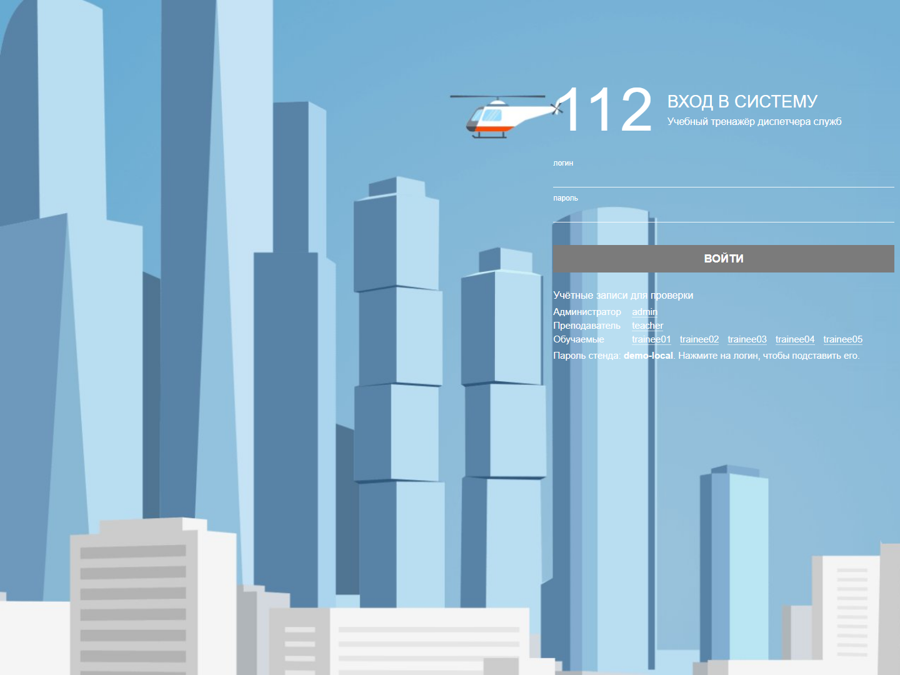
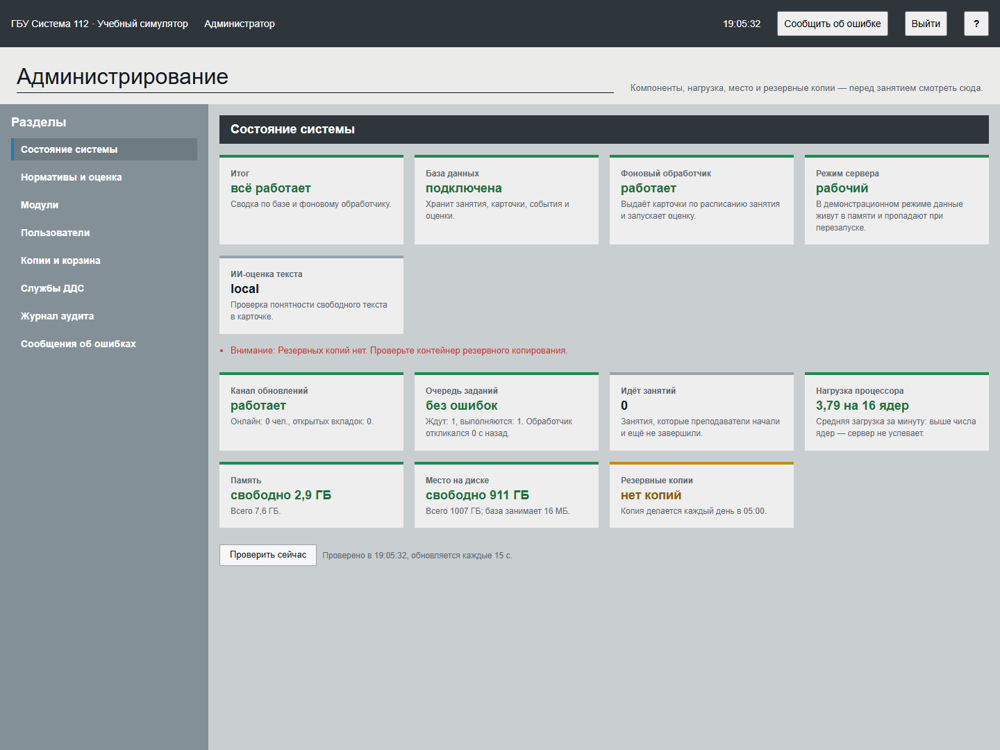
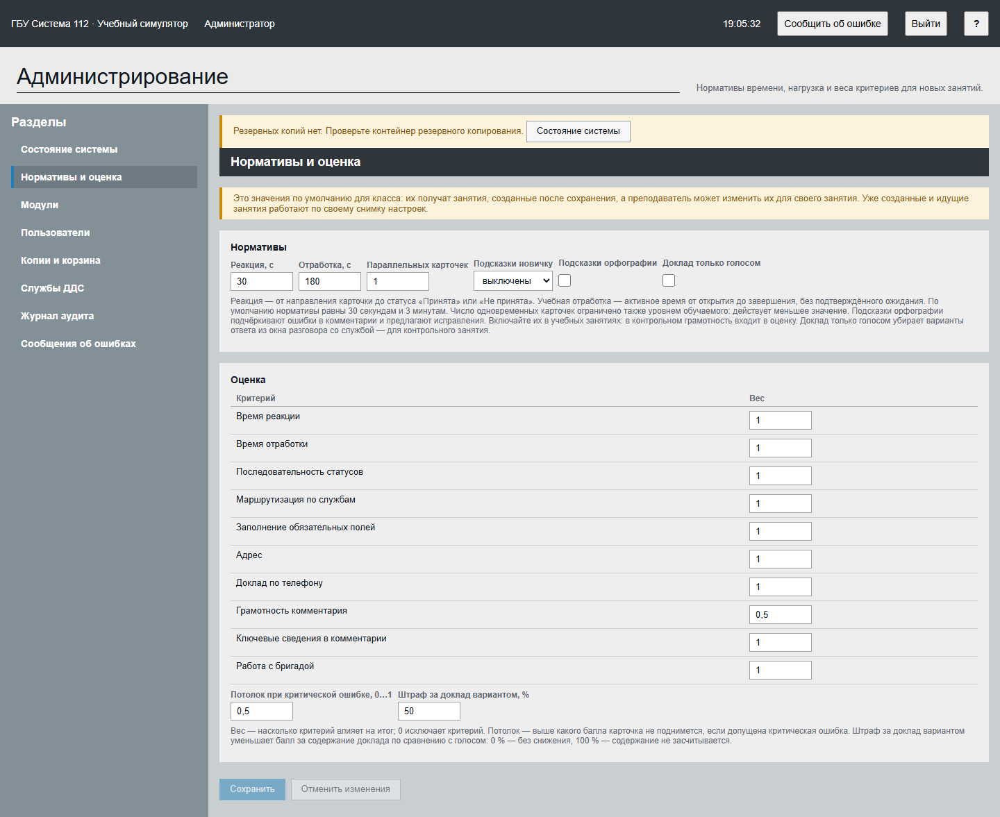
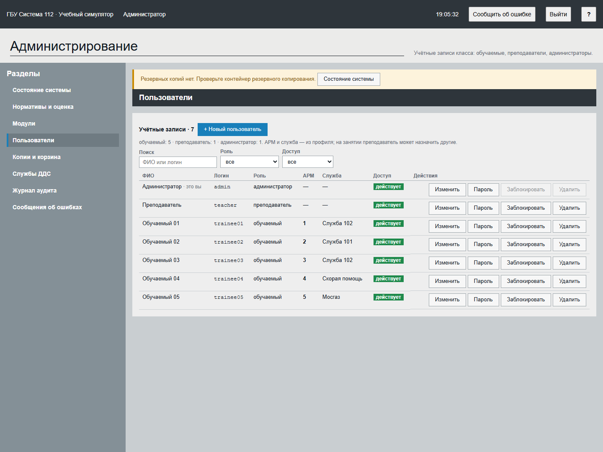
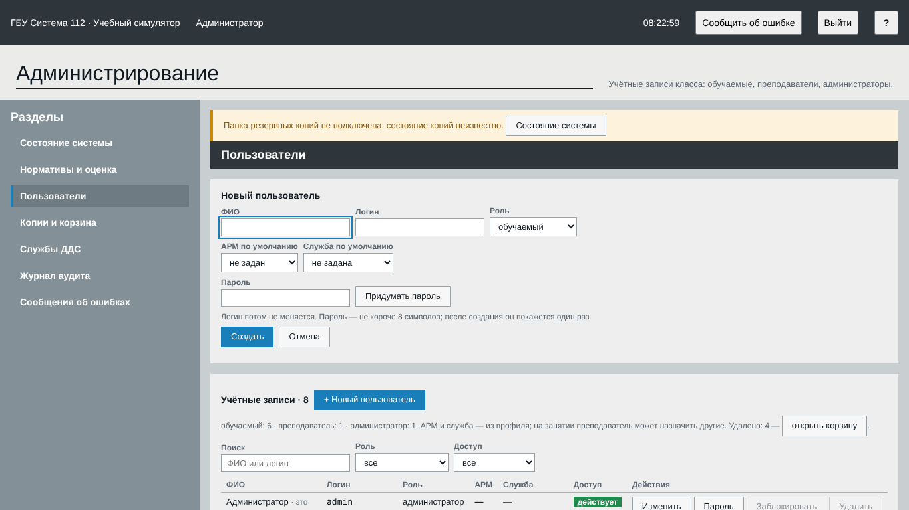
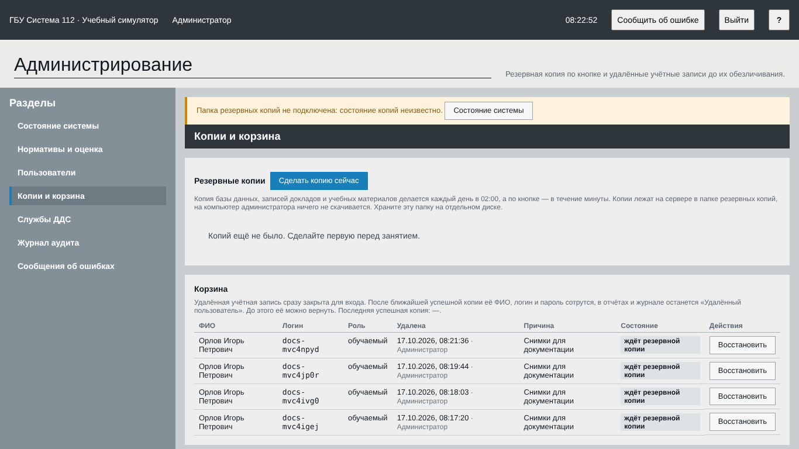
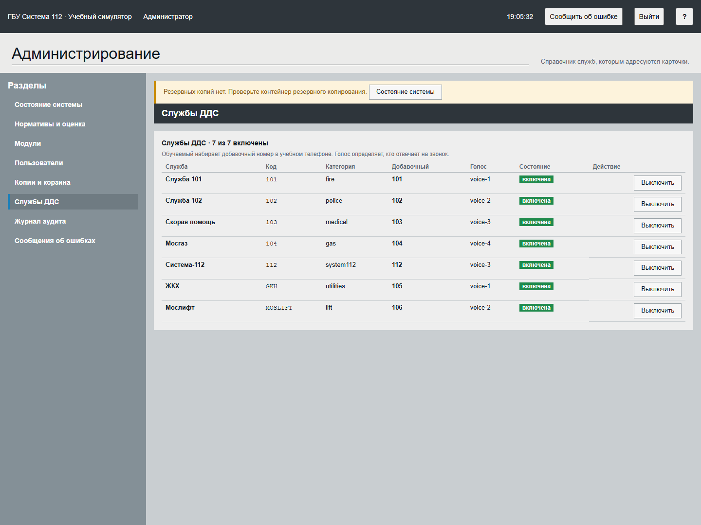
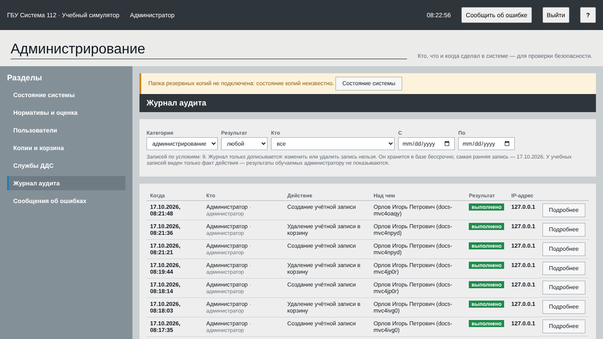
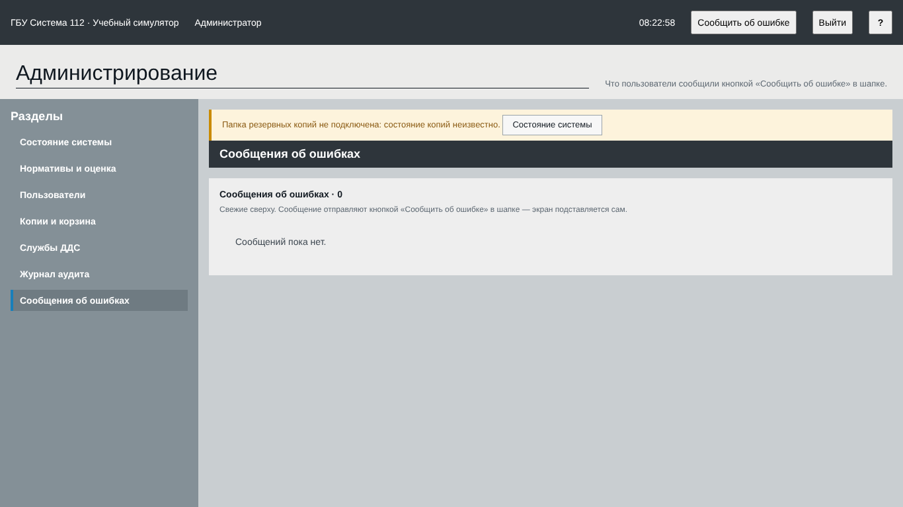

# 1. Что делает администратор

Администратор следит за состоянием тренажёра, настраивает оценку, ведёт учётные записи класса и резервные копии.
Установка и запуск сервера описаны в документе «Общее техническое описание». Здесь — работа в интерфейсе.

Администратор не видит результаты обучаемых: в журнале аудита по учебным действиям виден только факт действия.
Оценки и разборы смотрит преподаватель.

# 2. Вход

Откройте `https://<адрес сервера>/app/login`, введите логин и пароль администратора и нажмите «Войти».
На учебном стенде под формой показан список «Учётные записи для проверки»: нажмите на логин `admin`, и он вместе с паролем подставится в форму.
Этот список включается настройкой сервера `DEMO_ACCOUNTS_SHOWN`. На рабочем сервере отключите его и смените пароль учебных записей (раздел 6 технического описания).

После входа появится приветствие с порядком работы администратора: перед занятием, справочники, обратная связь. Нажмите «Начать работу».
Выйти можно кнопкой «Выйти» в шапке. Кнопка «?» объясняет части экрана, «Сообщить об ошибке» отправляет замечание в раздел «Сообщения об ошибках».

# 3. Экран администратора

Страница «Администрирование» состоит из списка разделов слева и рабочей области справа:

| Раздел | Для чего |
|---|---|
| «Состояние системы» | Работоспособность сервера: перед занятием смотреть сюда |
| «Модули» | Включение или скрытие отдельного обучения оператора 112; для занятий ДДС оставьте его выключенным |
| «Нормативы и оценка» | Значения по умолчанию для новых занятий |
| «Пользователи» | Учётные записи обучаемых, преподавателей и администраторов |
| «Копии и корзина» | Резервная копия по кнопке и удалённые учётные записи |
| «Службы ДДС» | Справочник служб, которым адресуются карточки |
| «Журнал аудита» | Кто, что и когда сделал в системе |
| «Сообщения об ошибках» | Замечания пользователей |

Над рабочей областью может появиться полоса с предупреждением о неполадке, например «Папка резервных копий не подключена: состояние копий неизвестно.» Она есть на каждом разделе, пока неполадка не устранена.

В разделе «Модули» флажок «Оператор 112» включает обучение приёму вызова. По умолчанию оно скрыто; при выключении данные этого модуля сохраняются, а доступ к нему закрывается. Для обычного занятия диспетчеров ДДС менять этот флажок не требуется.

# 4. Состояние системы

Вверху — итог: «всё работает» или перечень проблем. Ниже — плитки:

| Плитка | Что означает |
|---|---|
| «База данных» | Хранит занятия, карточки, события и оценки. Должна быть «подключена» |
| «Фоновый обработчик» | Выдаёт карточки по расписанию занятия и запускает оценку. Должен «работать» |
| «Режим сервера» | «рабочий»: данные хранятся в базе. В демонстрационном режиме данные пропадают при перезапуске |
| «ИИ-оценка текста» | «выключена» или работает: проверка понятности свободного текста в карточке локальной моделью |
| «Канал обновлений» | Передаёт события на экраны; показывает, сколько человек в сети и сколько вкладок открыто |
| «Очередь заданий» | Сколько заданий ждёт и выполняется, как давно откликался обработчик |
| «Идёт занятий» | Сколько занятий преподаватели начали и не завершили |
| «Нагрузка процессора» | Средняя загрузка за минуту: выше числа ядер — сервер не успевает |
| «Память» и «Место на диске» | Сколько свободно; на диске показано и место, которое занимает база |
| «Резервные копии» | Состояние резервных копий; при работающем контейнере копирования — каждый день в 02:00 UTC |

Страница обновляется каждые 15 секунд. Кнопка «Проверить сейчас» делает проверку немедленно. Готовность сервера не подтверждает качество генерации: перед контрольным занятием преподаватель отдельно проверяет выбранные задания и полный путь до разбора.
Выключенная «ИИ-оценка текста» не мешает занятию: оценка по правилам считается, а оценки в разборе помечаются «предварительно».

Перед занятием убедитесь, что итог — «всё работает», обработчик работает, на диске есть место, а последняя резервная копия свежая.

# 5. Нормативы и оценка

Раздел задаёт значения по умолчанию для класса. Их получат занятия, созданные после сохранения.
Преподаватель может изменить их для своего занятия, а уже созданные и идущие занятия работают по своему снимку настроек.

**Нормативы:**

- «Реакция, с» — время от направления карточки до статуса «Принята» или «Не принята». По умолчанию 30 секунд (памятка ДДС);
- «Отработка, с» — активное время от открытия до завершения, без подтверждённого ожидания. По умолчанию 3 минуты;
- «Параллельных карточек» — сколько карточек одновременно получает обучаемый. Действует меньшее из этого числа и уровня обучаемого;
- «Подсказки новичку» — «включены» или «выключены»;
- «Подсказки орфографии» — подчёркивают ошибки в комментарии и предлагают исправления. Включайте в учебных занятиях: в контрольном грамотность входит в оценку;
- «Доклад только голосом» — убирает варианты ответа из окна разговора со службой; для контрольного занятия.

**Оценка.** В таблице «Критерий — Вес» задайте вес каждого критерия: «Время реакции», «Время отработки», «Последовательность статусов», «Маршрутизация по службам», «Заполнение обязательных полей», «Адрес», «Доклад по телефону», «Грамотность комментария», «Ключевые сведения в комментарии», «Работа с бригадой».
Вес 0 исключает критерий. Ниже:

- «Потолок при критической ошибке, 0…1» — выше какого балла карточка не поднимется, если допущена критическая ошибка;
- «Штраф за доклад вариантом, %» — насколько снижается балл за содержание доклада по сравнению с голосом: 0 % — без снижения, 100 % — содержание не засчитывается.

Нажмите «Сохранить». Кнопка «Отменить изменения» возвращает сохранённые значения.

# 6. Пользователи

Таблица показывает ФИО, логин, роль, АРМ, службу, доступ («действует» или «заблокирован») и кнопки действий.
Над ней — сводка по ролям и фильтры: поле «Поиск» (ФИО или логин), списки «Роль» и «Доступ».
Роли: «обучаемый», «преподаватель», «администратор». АРМ и служба в таблице — из профиля обучаемого; на занятии преподаватель может назначить другие.

## Создать пользователя

1. Нажмите «+ Новый пользователь».
2. Заполните «ФИО» и «Логин». Логин: от 3 до 32 символов — строчные латинские буквы, цифры, точка, дефис или подчёркивание, начинается с буквы или цифры. Потом он не меняется.
3. Выберите «Роль».
4. Для обучаемого выберите «АРМ по умолчанию» (от 1 до 23) и «Служба по умолчанию».
5. Введите «Пароль» не короче 8 символов или нажмите «Придумать пароль».
6. Нажмите «Создать». Пароль покажется один раз: передайте его пользователю.

## Остальные действия

- **«Изменить»** — ФИО, роль, АРМ и служба. Смена роли закрывает сеансы пользователя; если у него уже есть занятия или материалы, роль не меняется — заведите новую учётную запись. Свою роль и доступ меняет другой администратор.
- **«Пароль»** — новый пароль. Откроется форма «Новый пароль: логин»; нажмите «Сохранить пароль». Все сеансы пользователя закроются, а новый пароль покажется один раз.
- **«Заблокировать»** — закрывает вход, открытые вкладки завершаются сразу. История занятий и оценок сохраняется. Подтвердите кнопкой «Да, заблокировать». Для возврата нажмите «Разблокировать».
- **«Удалить»** — напишите причину в поле «Причина удаления» и нажмите «Удалить в корзину». Пользователь сразу выходит из системы. После ближайшей успешной резервной копии его ФИО, логин и пароль стираются, в отчётах остаётся «Удалённый пользователь». До копии учётную запись можно вернуть (раздел 7).

# 7. Копии и корзина

**Резервные копии.** При запущенном контейнере резервного копирования копия базы данных, записей докладов и учебных материалов делается каждый день в 02:00 UTC (05:00 по Москве).
Кнопка «Сделать копию сейчас» запускает копию вручную: она делается в течение минуты.
Копии лежат на сервере в папке резервных копий, на компьютер администратора ничего не скачивается. Храните эту папку на отдельном диске.
Список копий и их результат виден в этом разделе. Перед занятием желательно сделать первую копию.

**Корзина.** Удалённая учётная запись сразу закрыта для входа. Пока копия не сделана, запись можно вернуть кнопкой «Восстановить».
Под таблицей указана «Последняя успешная копия».

Восстановление данных из копии выполняется на сервере в новый проект (описано в техническом описании, раздел 8), а не в интерфейсе.

# 8. Службы ДДС

Таблица: служба, код, категория, добавочный номер, голос и состояние.
Обучаемый выбирает абонента в телефоне ДДС или набирает номер. В актуальных сценариях собеседники звучат записями банка: значение голоса старого справочника не означает, что все реплики будут озвучены одним прежним голосом.

Кнопка «Выключить» убирает службу: в неё нельзя будет позвонить и перенаправить карточку, её не будет в новых занятиях и пакетах. Сценарии и история сохраняются. Подтвердите кнопкой «Да, выключить». Кнопка «Включить» возвращает службу.
Пока служба участвует в идущем занятии, выключить её нельзя.

В справочнике: «Служба 101» (пожарная охрана), «Служба 102» (полиция), «Скорая помощь» (добавочный 103), «Мосгаз» (104), «ЖКХ» (105), «Мослифт» (106) и «Система-112» (112).

# 9. Журнал аудита

Журнал показывает, кто, что и когда сделал: время, пользователь, действие, объект, результат и IP-адрес.
Фильтры: «Категория» (администрирование, входы и выходы, учебный процесс, технические), «Результат» (выполнено, отказ), «Кто», даты «С» и «По».
Кнопка «Подробнее» раскрывает запись, «Показать ещё» подгружает следующие.

Журнал только дописывается: запись нельзя изменить или удалить. Он хранится в базе бессрочно и входит в резервную копию.
По учебным записям виден только факт действия; результаты обучаемых администратору не показываются.

# 10. Сообщения об ошибках

Здесь собраны замечания, которые пользователи отправили кнопкой «Сообщить об ошибке» в шапке: свежие сверху, экран подставляется сам.
Разберите их после каждого занятия и передайте разработчикам.

# 11. Подготовка к занятию

1. Откройте «Состояние системы»: итог «всё работает», обработчик работает, диск не заполнен.
2. Проверьте «Пользователи»: у каждого обучаемого есть учётная запись, АРМ и служба.
3. Проверьте «Службы ДДС»: нужные службы включены.
4. Проверьте «Нормативы и оценка»: нормативы и веса подходят для занятия.
5. Нажмите «Сделать копию сейчас» в разделе «Копии и корзина».
6. Сообщите преподавателю, что тренажёр готов.

# 12. Если что-то не работает

| Что случилось | Что делать |
|---|---|
| Итог не «всё работает» | Откройте плитку с проблемой. Если обработчик не работает, перезапустите сервис `worker` (техническое описание, раздел 9) |
| Пользователь не входит | Проверьте в «Пользователи», что учётная запись «действует», а не «заблокирован». Задайте новый пароль кнопкой «Пароль» |
| Нет резервных копий | Проверьте, что папка резервных копий подключена к серверу; нажмите «Сделать копию сейчас» |
| Нельзя выключить службу | Она участвует в идущем занятии: дождитесь его завершения |
| Нельзя сменить роль | У пользователя уже есть занятия или материалы: заведите новую учётную запись |
| Преподаватель не видит нужную службу | Включите её в разделе «Службы ДДС» |
| Нужно узнать, кто менял настройки | Откройте «Журнал аудита», категория «администрирование» |
