# 1. Что делает преподаватель

Преподаватель готовит занятие, выдаёт задания обучаемым, наблюдает за работой, проверяет оценки и по итогам назначает следующее занятие.
На вашем занятии обучаемые получают задания из выданного вами плана. Вне занятия они могут сами запустить «Тренировку», «Мой путь» или «Каталог сценариев».

Схема работы тренажёра: преподаватель выдаёт задание, обучаемый работает диспетчером своей службы, система оценивает действия и показывает разбор, преподаватель принимает или меняет оценку и получает рекомендации к дальнейшему обучению.

Что делает система сама:

- создаёт карточку у обучаемого в назначенное время;
- играет бригады: они выезжают, докладывают, звонят и ошибаются;
- считает время и оценку по правилам; текст комментария дополнительно проверяет локальная модель, если она включена;
- собирает отчёт и предлагает уровень сложности для следующего занятия.

# 2. Вход и кабинет

Откройте `https://<адрес сервера>/app/login`, введите логин и пароль и нажмите «Войти».
На учебном стенде под формой есть список «Учётные записи для проверки»: нажмите на логин `teacher`, и он вместе с паролем подставится в форму.
При первом входе появится приветствие с порядком проведения занятия. Нажмите «Начать работу».

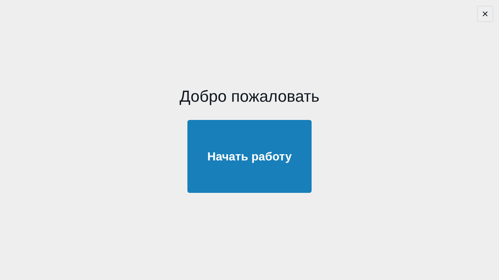

Кабинет делится на две части.

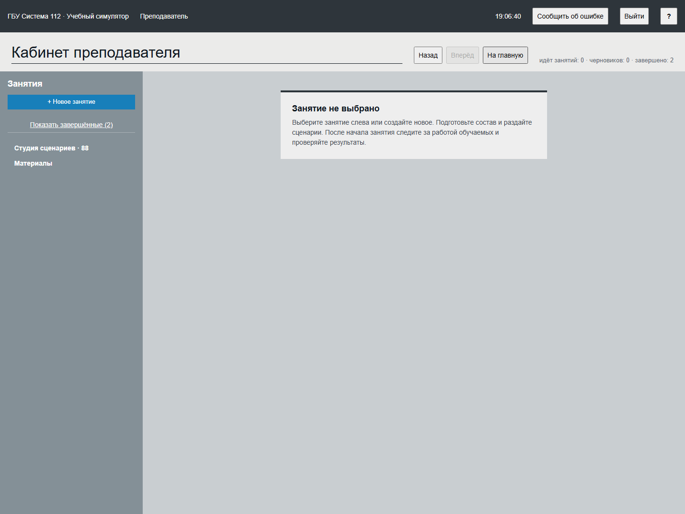

**Слева** — список занятий:

- «+ Новое занятие» — создать занятие;
- занятия с пометками «черновик», «идёт», «завершено»; завершённые скрыты — их показывает «Показать завершённые», а найти нужное можно в поле «Поиск завершённых занятий»;
- «Студия сценариев» — каталог сценариев и генерация пакетов (раздел 9);
- «Материалы» — учебные материалы и справка (раздел 10).

**Справа** — выбранное занятие. Кнопки «Назад», «Вперёд» и «На главную» вверху ходят по открытым экранам.
Справа от них написано, сколько занятий идёт, сколько черновиков и сколько завершено.

В шапке есть «?»: кнопка объясняет части экрана номерами и пояснениями. «Сообщить об ошибке» отправляет замечание администратору.

# 3. Порядок проведения занятия

1. Создайте занятие: название, рабочие места, обучаемые, службы и уровни (раздел 4).
2. При необходимости настройте телефон ДДС и нормативы занятия.
3. Раздайте сценарии каждому месту (раздел 5) и назначьте справку.
4. Нажмите «Начать занятие».
5. Наблюдайте на вкладке «Ход занятия» и при необходимости подавайте вводные (раздел 7).
6. Завершите занятие и проверьте вердикты (раздел 8).
7. Откройте отчёт, посмотрите типичные ошибки и создайте следующее занятие (раздел 8).

# 4. Новое занятие

Нажмите «+ Новое занятие».

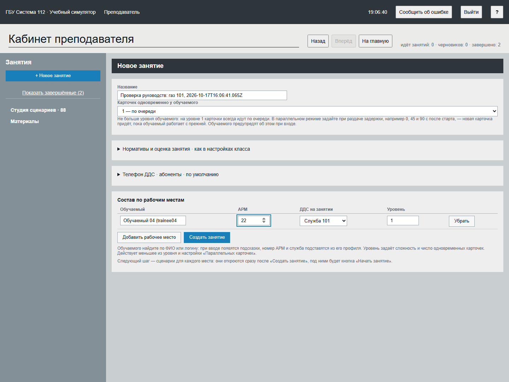

1. В поле «Название» напишите название занятия.
2. В списке «Карточек одновременно у обучаемого» выберите «1 — по очереди», «2 — параллельно» или «3 — параллельно». Число ограничено уровнем обучаемого: на уровне 1 карточки всегда идут по очереди. В параллельном режиме задайте при раздаче разные задержки, например 0, 45 и 90 секунд.
3. В блоке «Состав по рабочим местам» нажмите «Добавить рабочее место». Для каждого места укажите:
   - «Обучаемый» — введите ФИО или логин, появятся подсказки;
   - «АРМ» — номер рабочего места; он и служба подставятся из профиля обучаемого;
   - «ДДС на занятии» — служба, за которую работает обучаемый;
   - «Уровень» — сложность от 1 до 4: простой, средний, сложный, особо сложный.
4. «Убрать» удаляет лишнее место.
5. Нажмите «Создать занятие».

Занятие появится в списке со значком «черновик». Пока оно не начато, состав можно менять.

## Нормативы и оценка занятия

Раскрывающийся блок «Нормативы и оценка занятия» показывает значения, заданные администратором для класса: реакция 30 секунд, отработка карточки 3:00.
Здесь их можно изменить только для этого занятия: нормативы, число параллельных карточек, подсказки новичку, подсказки орфографии, доклад только голосом, веса критериев, потолок при критической ошибке и штраф за доклад вариантом.
Кнопка «Вернуть настройки класса» отменяет ваши изменения. Настройки класса и занятия коллег не меняются.

Вес критерия показывает, насколько он влияет на итог; 0 исключает критерий. Штраф за доклад вариантом уменьшает балл за содержание доклада по сравнению с голосом: 0 % — без снижения, 100 % — содержание не засчитывается.
Для контрольного занятия включите «Доклад только голосом» и выключите «Подсказки новичку» и «Подсказки орфографии».

## Телефон ДДС: абоненты

Раскрывающийся блок «Телефон ДДС · абоненты» задаёт, кому обучаемый может позвонить, кроме бригад и служб.

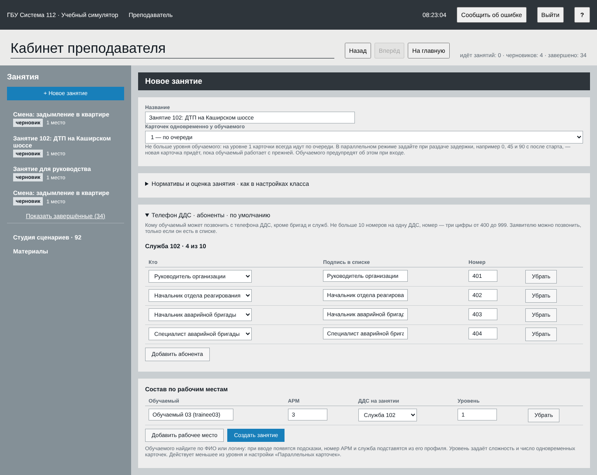

- Для каждой ДДС занятия есть свой список, не больше 10 номеров.
- Номер — три цифры от 400 до 999, номера в списке не повторяются.
- В строке выберите роль в списке «Кто»: «Руководитель организации», «Начальник отдела реагирования», «Начальник аварийной бригады», «Специалист аварийной бригады» или «Заявитель». В поле «Подпись в списке» можно написать своё название.
- «Добавить абонента» добавляет строку, «Убрать» удаляет, «Вернуть по умолчанию» восстанавливает стандартный список: четыре номера 401–404.
- Заявителю обучаемый может позвонить, только если он есть в списке. Включайте его только в простых бытовых сценариях.

Для готового сюжета «Котёнок в вентиляционной шахте» добавьте абонента с ролью «Заявитель» и номером 458 в список ЖКХ. Доступ задаётся для ДДС всего занятия, а не отдельной карточки: не смешивайте в одном таком занятии задания, где звонок заявителю недопустим. Обучаемый сможет выбрать контакт или набрать полный телефон из карточки (`+7…`, `8…` или десять цифр); тренажёр сопоставит его с разрешённым абонентом.

# 5. Раздача заданий

После создания открывается вкладка «Состав и раздача». Вверху показан состав, ниже — «Адресная выдача»: у каждого места своя очередь заданий.

Рядом с задержками выдачи проверьте «Отработка карточки» — по умолчанию 3:00. До «Начать занятие» преподаватель может изменить норматив в формате мм:сс (0:01–60:00): уход с поля или Enter сохраняет его с подтверждением «Сохранено». Сверх этого времени балл за время снижается; ожидание доклада бригады не считается. После старта норматив только отображается: все карточки занятия оцениваются по одному нормативу.

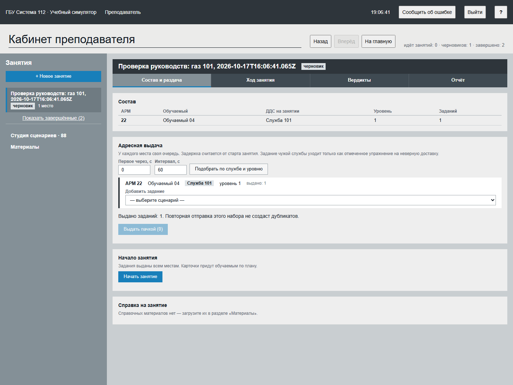

## Подобрать автоматически

1. Задайте «Первое через, с» (по умолчанию 10) и «Интервал, с» (по умолчанию 60). Задержка считается от старта занятия.
2. Нажмите «Подобрать по службе и уровню». Каждому месту подберутся утверждённые сценарии его службы и его уровня, в которых бригада докладывает до завершающего статуса: такую карточку обучаемый сможет закрыть.
3. Проверьте очереди. Задержку в поле «через, с» можно изменить, строку убрать кнопкой ✕, а весь план очистить кнопкой «Очистить план».
4. Нажмите «Выдать задания (N)».

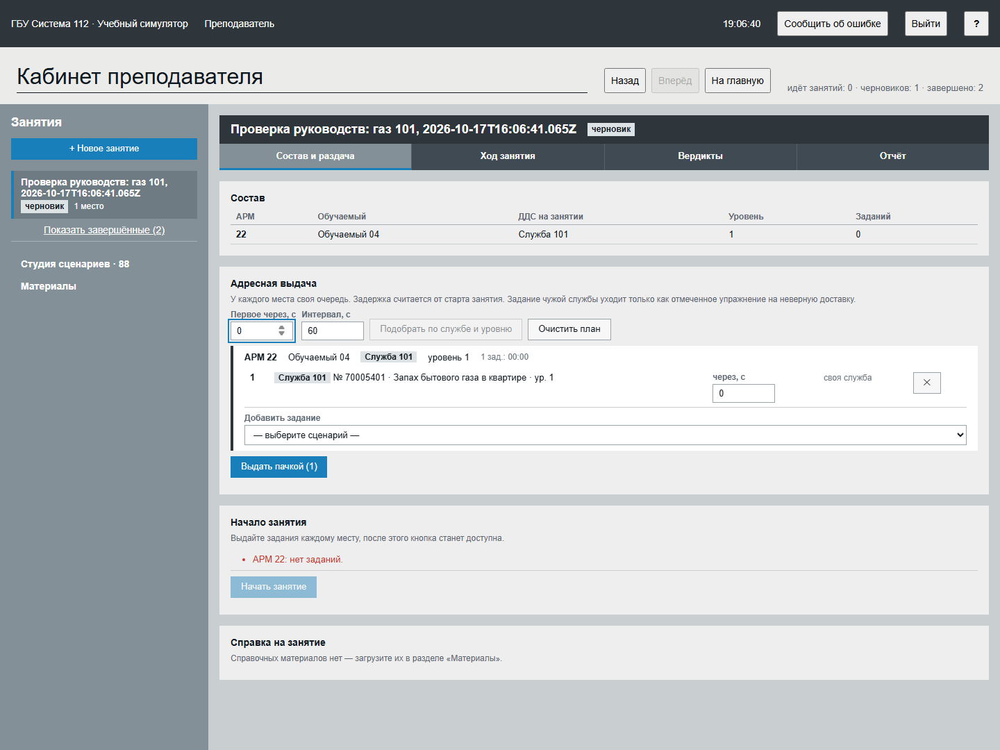

После выдачи появится сообщение «Выдано заданий: N. Повторная отправка этого набора не создаст дубликатов.»

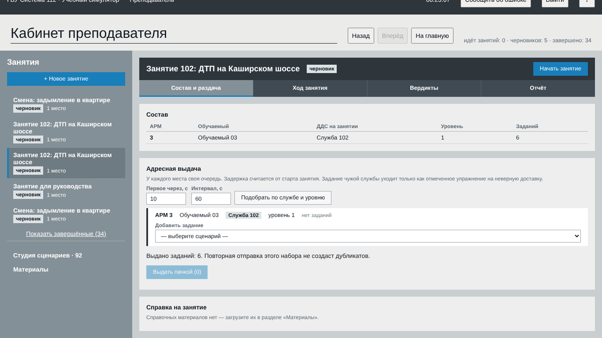

## Выбрать вручную

В очереди места выберите сценарий в списке «Добавить задание». Сценарии службы обучаемого собраны в группе «Своя служба».
Задание чужой службы уходит только как отмеченное упражнение на неверную доставку.

Для обычного занятия выдавайте сценарии набора на финал (раздел 11): у них продуман ход разговора, ошибки и исход.

## Справка на занятие

Блок «Справка на занятие» внизу вкладки назначает обучаемым учебные материалы. Отметьте нужные и нажмите «Назначить справку». Материалы назначаются только до начала занятия.
Если материалов нет, загрузите их в разделе «Материалы».

## Начало занятия

Кнопка «Начать занятие» вверху станет доступной, когда у каждого места есть задание. Пока это не так, над вкладками написано, чего не хватает, например «АРМ 3: нет заданий.»
Нажмите «Начать занятие»: карточки придут обучаемым по плану. Открывается вкладка «Ход занятия».

# 6. Что видит обучаемый

Во время занятия обучаемый работает в окне диспетчера: список происшествий, карточка, телефон ДДС. Подробности — в руководстве обучаемого.
Рабочее место обучаемого повторяет интерфейс системы-112 и не меняется. Вы не видите его экран, но видите состояние каждого места на вкладке «Ход занятия».

# 7. Ход занятия

Вкладка «Ход занятия» показывает доску занятия: плитка на каждое рабочее место.

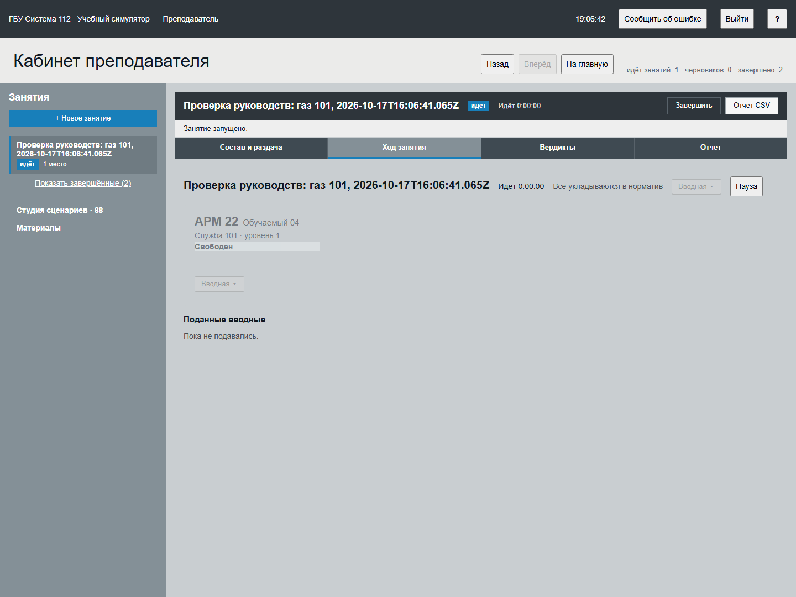

В плитке — номер АРМ, обучаемый, служба и уровень, состояние и обратный отсчёт норматива:

- «Не в сети» — обучаемый ещё не открыл тренажёр;
- «Свободен» — карточек в работе нет;
- «Карточка не открыта» — карточка пришла, обучаемый её не открыл;
- «Ждёт показа на АРМ» — карточка ожидает показа;
- «Статус не поставлен» — карточка открыта, идёт отсчёт реакции;
- «В работе» — идёт отработка карточки.

Цифры «осталось 0:27» показывают время до норматива, после срока — «просрочено на». Над плитками написано «Все укладываются в норматив» или сколько мест просрочили.
Доска узнаёт, что обучаемый в сети, в момент его входа. Откройте «Ход занятия» до того, как обучаемые войдут: если они вошли раньше, их плитки могут показывать «Не в сети», хотя обучаемый работает.

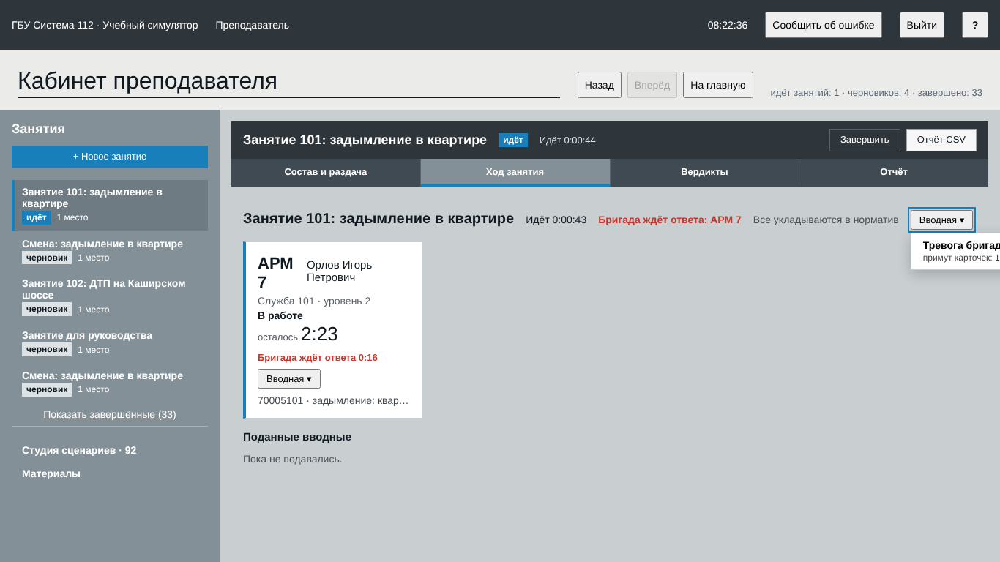

## Вводные

Кнопка «Вводная ▾» подаёт событие сценария по ходу занятия: для всех мест (в шапке доски) или для одного места (в его плитке).
В меню — события, которые можно подать в открытых карточках, например «Тревога бригады»: бригада звонит с сообщением о беде, обучаемый должен сразу ответить и вызвать скорую или систему-112.
Под названием пункта написано, сколько карточек примут вводную. Если подавать нечего, кнопка неактивна: в открытых карточках нет подходящих событий.
Список поданных вводных — «Поданные вводные» под доской. Вводную нельзя подать во время разговора обучаемого с бригадой и в первые 10 секунд после него: подайте её снова.

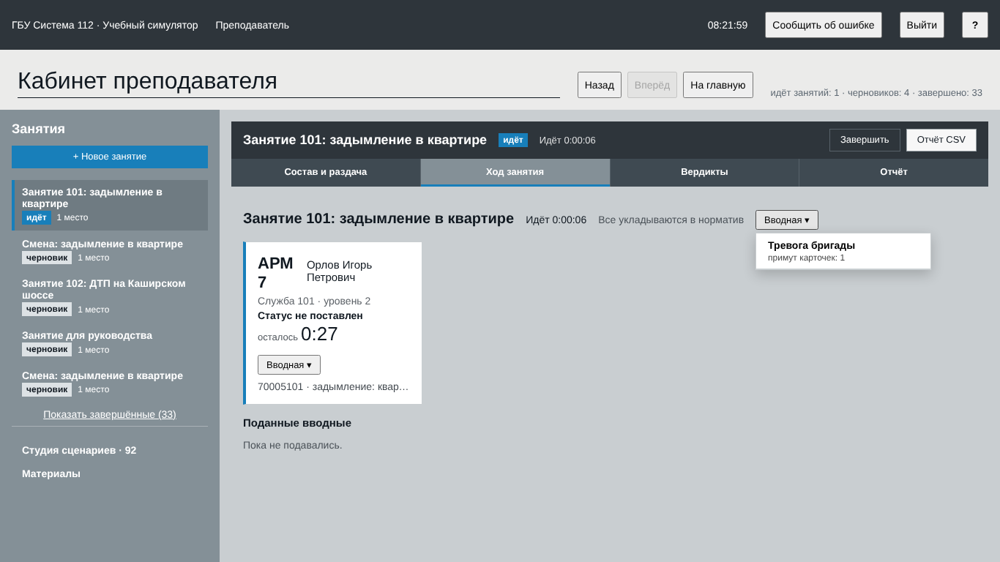

## Завершение

Кнопка «Завершить» вверху останавливает занятие. Карточки, которые обучаемый не закрыл, получают пометку «Попытка прервана завершением занятия».
Когда все обучаемые закрыли все карточки, появится окно «Все обучаемые завершили задания». Занятие завершится автоматически через 2 минуты. Кнопка «Завершить сейчас» завершает его сразу, «Не завершать» оставляет занятие открытым.
Кнопка «Отчёт CSV» выгружает отчёт в файл.

# 8. Оценки, отчёт и рекомендации

## Оценки

На вкладке «Оценки» — оценка каждой закрытой карточки: балл, обучаемый, происшествие и таблица критериев с пояснением, почему поставлен балл.

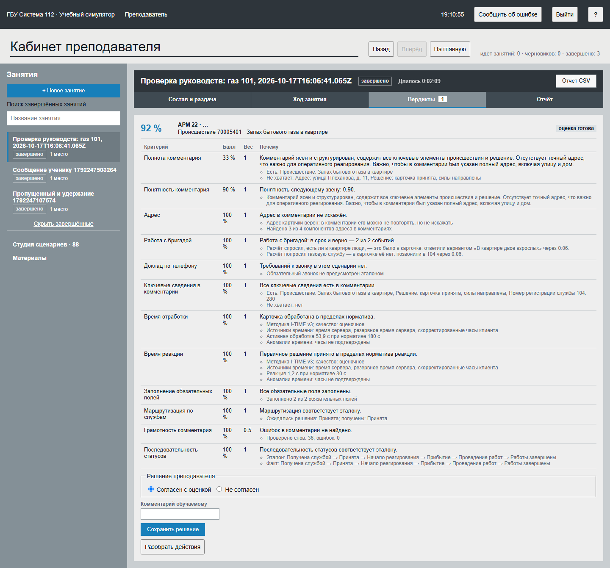

Оцениваются: время реакции, время отработки, последовательность статусов, маршрутизация по службам, заполнение обязательных полей, адрес, доклад по телефону, грамотность комментария, ключевые сведения в комментарии и работа с бригадой.
Для работы с бригадой в пояснении перечислены события сценария: что сделал обучаемый и вовремя ли, например «ответили вариантом «Понял», не поправили — расчёт приехал не туда».

Пометка «предварительно» означает, что правила посчитаны, а оценка текста комментария моделью не выполнена: модель выключена или ещё работает. Балл по правилам действителен.

Под баллом видно, выставлен ли он автоматически или изменён преподавателем, а также
причину последнего решения. При повторном открытии форма сохраняет последнее решение и
новый балл; кнопка сохранения активируется после загрузки текущего разбора.

Решение преподавателя:

1. Выберите «Согласен с оценкой» или «Не согласен».
2. При несогласии выберите «Причина несогласия» («Не согласен с системой», «Система неверно рассчитала» или «Другое» — тогда впишите, что не так) и укажите «Новый балл, %» от 0 до 100.
3. При желании напишите «Комментарий обучаемому»: он увидит его в разборе.
4. Нажмите «Сохранить решение». Причина попадает в журнал.

Кнопка «Разобрать действия» открывает разбор по секундам: шкалу времени с красными засечками ошибок, журнал событий и карточку на выбранной секунде. Кнопки «следующая ошибка →» и «← предыдущая ошибка» переходят к ошибкам. Кнопка «Скрыть разбор» закрывает его.

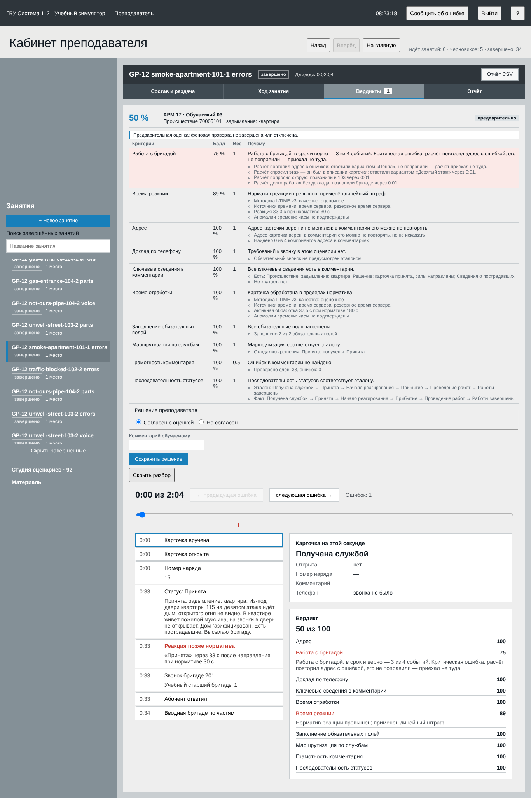

## Отчёт

Вкладка «Отчёт» собирает итоги занятия.

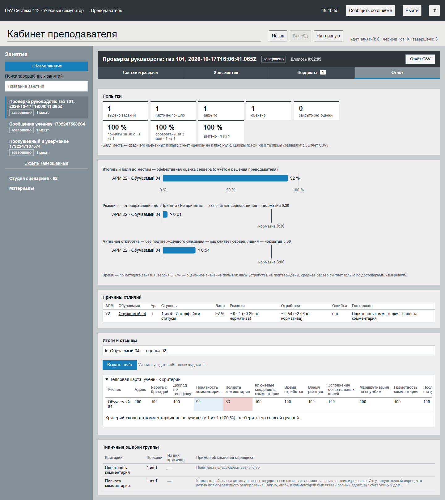

- «Попытки»: выдано заданий, карточек пришло, закрыто, оценено, из них предварительно,
  закрыто без оценки; доли карточек, принятых за 30 секунд, обработанных за 3 минуты и
  зачтённых по готовым разборам или решению преподавателя.
- Графики: итоговый балл по местам, время реакции и время активной отработки с линиями нормативов.
- «Причины отличий» — таблица по местам: балл, реакция, отработка, ошибки и «Где просел».
- «Типичные ошибки группы» — критерии, на которых просели обучаемые, и пример объяснения.

Цифры отчёта совпадают с файлом «Отчёт CSV».

## Рекомендации к дальнейшему обучению

В таблице «Причины отличий» нажмите на имя обучаемого. Раскроется «Разбор: АРМ … · … · уровень …».

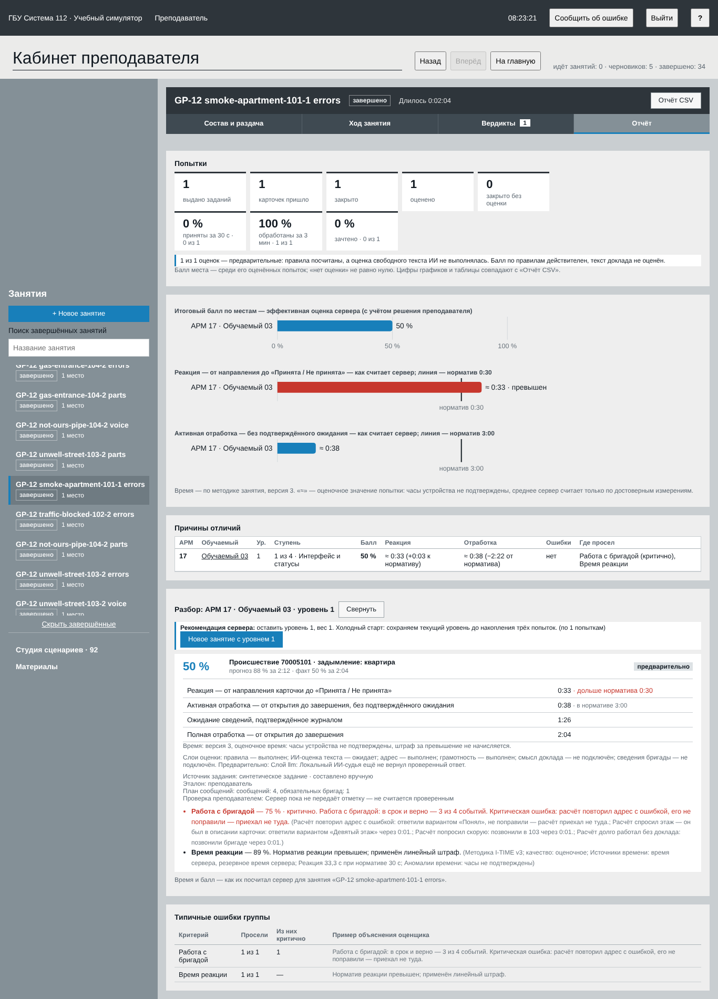

В нём — рекомендация по сложности («повысить до», «оставить», «понизить до») с обоснованием и числом попыток, по которым она сделана. При стабильно высоких оценках без критических ошибок уровень повышается, при критической ошибке или низкой оценке — понижается. Если данных мало, система так и пишет.
Кнопка «Новое занятие с уровнем N» создаёт новое занятие с этим обучаемым и рекомендованным уровнем.

Ниже — оценки по каждой карточке, критерии, где обучаемый набрал меньше максимума, и строки времени.
«Свернуть» закрывает разбор.

Обучаемый видит те же замечания в разделе «Мои результаты» и подсказку «Главное на следующую попытку».

# 9. Студия сценариев

«Студия сценариев» в левом списке открывает каталог.

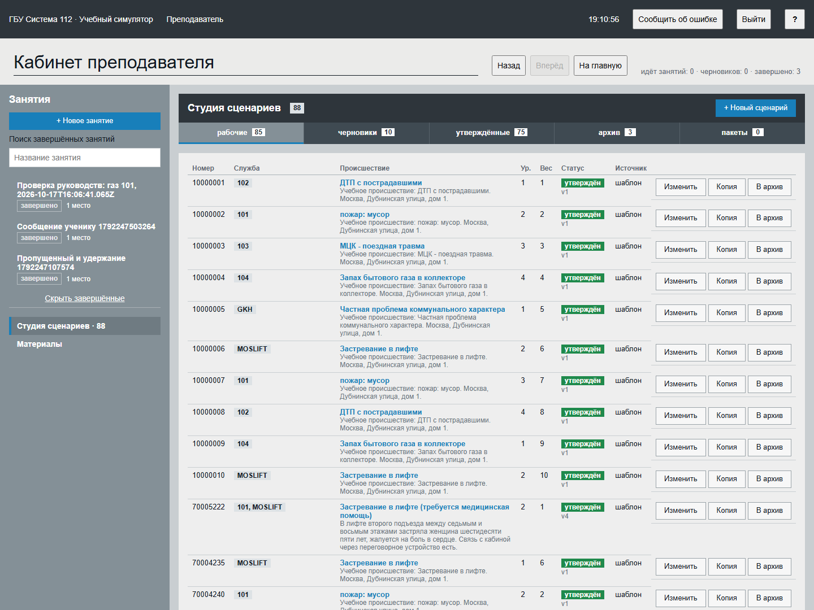

Вкладки каталога: «рабочие», «черновики», «утверждённые», «архив» и «пакеты».
В таблице — номер, служба, происшествие, уровень, вес, статус и источник («шаблон», «сгенерирован ИИ», «импорт», «от обучаемого»). В строке кнопки «Изменить», «Копия» и «В архив».
В плане занятия выдать можно только утверждённый сценарий. Отдельное исключение — пакет «Сгенерировано для тренировок»: самостоятельная тренировка может выдать его проверенный генератором черновик до утверждения преподавателем. Просматривайте этот пакет; отклонённый сценарий уходит в архив и больше не выдаётся. Сценарий, который уже выдан на занятии, менять нельзя, чтобы не разошлись результаты: нажмите «Копия» и работайте с копией.

## Новый сценарий

«+ Новый сценарий» открывает редактор.

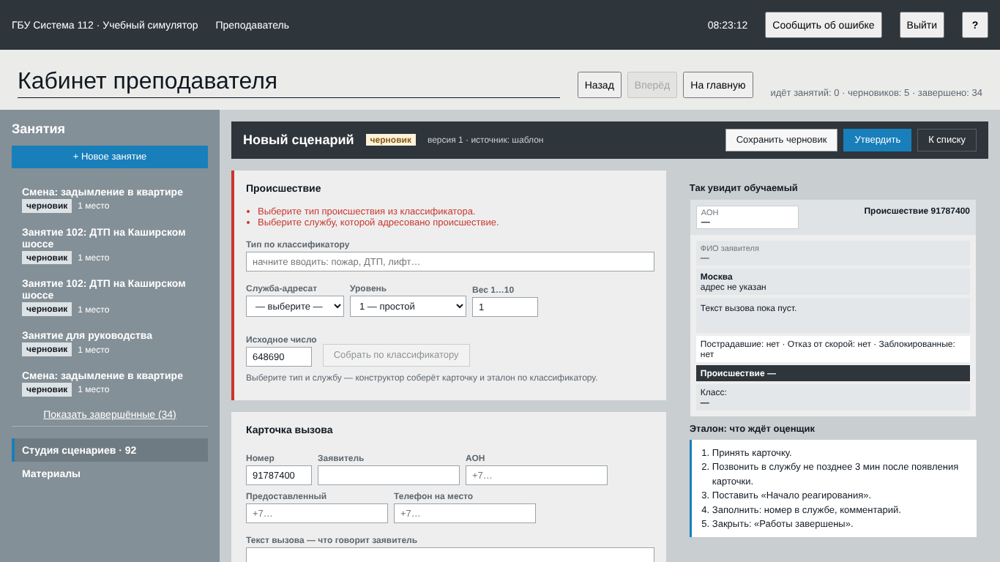

1. Выберите «Тип по классификатору», «Служба-адресат», «Уровень» и нажмите «Собрать по классификатору»: конструктор соберёт карточку и эталон. Можно заполнить всё вручную.
2. В блоке «Карточка вызова» заполните номер, заявителя, телефоны, текст вызова, признаки, осложнения и адрес.
3. В блоке «Эталон — как правильно» задайте исход карточки, службы, обязательные поля, комментарий по смыслу, ключевые слова и звонок в службу.
4. В редакторе виден предпросмотр: «Так увидит обучаемый» и «Эталон: что ждёт оценщик».
5. Нажмите «Сохранить черновик», а когда сценарий готов, «Утвердить». «К списку» возвращает в каталог.

Сценарий из студии содержит карточку и эталон оценки. Доклады бригады в студии не задаются: они есть у готовых сценариев каталога ДДС. Для занятий с бригадами используйте их.

## Пакеты и генерация

Вкладка «пакеты» позволяет получить несколько сценариев сразу.

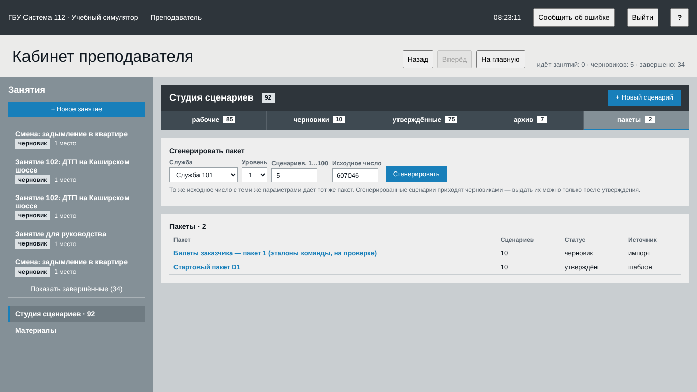

1. В блоке «Сгенерировать пакет» выберите «Служба», «Уровень», «Сценариев, 1…100» и «Исходное число».
2. Нажмите «Сгенерировать». Прогресс виден на экране. То же исходное число с теми же параметрами даёт тот же пакет.
3. Сгенерированные сценарии приходят черновиками. Откройте пакет, нажмите «Отметить все готовые» и «Утвердить отмеченные (N)». Утверждаются все отмеченные сценарии или ни одного.
4. Сценарий, требующий правки, откройте в редакторе: рядом со строкой написана причина.

Генератор строит сценарии по шаблонам службы и классификатору происшествий. Если на сервере включена локальная модель, она может подготовить текст описания. Только принятый после проверки ответ получает источник «сгенерирован ИИ». Без модели либо при отклонённом ответе возможен источник «шаблон»; само включение модели не доказывает, что она создала этот сценарий.
Сценарии пакета студии перед выдачей на занятие вы проверяете и утверждаете сами. Автоматическая подготовка недостающих карточек для «Моего пути» использует отдельный шаблонный путь и пакет «Сгенерировано для тренировок».

# 10. Материалы

Раздел «Материалы» хранит учебные файлы.

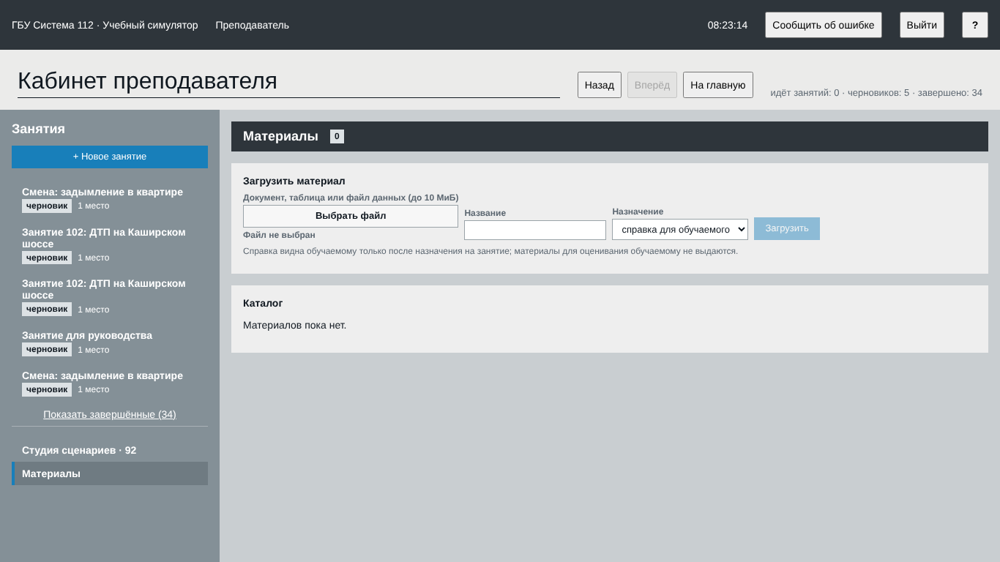

1. Нажмите «Выбрать файл» (документ, таблица или файл данных до 10 МиБ).
2. Напишите «Название» и выберите «Назначение»: «справка для обучаемого» или «только для оценивания».
3. Нажмите «Загрузить».

Справка видна обучаемому только после назначения на занятие (блок «Справка на занятие», раздел 5). Материалы «только для оценивания» обучаемому не выдаются.

# 11. Готовые сценарии набора на финал

По одному продуманному сценарию на службу плюс бытовой сценарий со звонком заявителя. У каждого есть полный план докладов бригады, ловушки и исход.

| Служба | Сценарий | Чему учит |
|---|---|---|
| 101 | Задымление в квартире, Бескудниковский бульвар, 24 | Бригада повторяет адрес с ошибкой, спрашивает этаж, просит скорую; доступна вводная «Тревога бригады» |
| 102 | ДТП, водитель зажат в машине, Каширское шоссе, 26 | Участники уехали до прибытия: верный статус «Отказ от выполнения работ» |
| 103 | Человеку плохо на улице | Отказ от госпитализации: «Работы завершены» без отказа, у скорой нет статуса «Отказ от выполнения работ» |
| 104 | Запах газа в подъезде | Нужна пожарная охрана: звонок в систему-112 об изменении обстановки |
| 104 | Не наша карточка: течь в подвале дома без газа | Верное решение — «Не принята» с причиной и перенаправление |
| ЖКХ | Котёнок в вентиляционной шахте | Звонок заявителю: возможен, только если вы включили его в телефон ДДС |

Сценарии 101–104 также включают звонок отдела контроля, если обучаемый слишком долго не принимает решение.
Звонить заявителю можно только по телефону ДДС занятия, поэтому бытовой сценарий ЖКХ выдавайте на занятии с вашими абонентами; в самостоятельной тренировке без преподавателя он не выдаётся.

# 12. Рекомендации по проведению

- Перед занятием проверьте у администратора раздел «Состояние системы»: «всё работает».
- Откройте «Ход занятия» до входа обучаемых, тогда видно, кто в сети.
- Для первого занятия выберите уровень 1 и карточки по очереди. Параллельную работу включайте с уровня 2.
- Если обучаемый просрочил реакцию, сначала посмотрите в разборе, что он делал в это время.
- Не завершайте занятие, пока обучаемые не закрыли карточки: незакрытые попытки получают пометку «прервана завершением занятия».

# 13. Возможные затруднения

| Что случилось | Что делать |
|---|---|
| «Начать занятие» неактивна | Раздайте задания каждому месту: причина написана над вкладками |
| «Выдать задания» отказывает | Прочитайте красное пояснение у строки: служба сценария не совпадает со службой места, задержки убывают или сценарий не утверждён |
| Обучаемый «Не в сети» | Он ещё не вошёл в тренажёр или закрыл вкладку. Попросите открыть адрес и нажать «Перейти в тренажёр» |
| Вводная неактивна | В открытых карточках нет событий, которые можно подать. Дождитесь, пока обучаемый откроет карточку |
| Оценка «предварительно» | Проверка текста моделью не завершена или выключена. Балл по правилам уже действует |
| Нужно изменить сценарий, который уже выдавали | Нажмите «Копия» (в редакторе — «Создать копию») и измените копию: история занятий исходного сценария сохранится |
| Не помните, что значит кнопка | Нажмите «?» в шапке |
