# 1. Для чего нужен тренажёр

Тренажёр учит работать диспетчером дежурно-диспетчерской службы (ДДС): 101, 102, 103, 104 и других.
Реальных вызовов в нём нет, ошибаться во время обучения нормально.

Вы получаете карточку происшествия от системы-112 и принимаете решение: «Принята» или «Не принята».
Затем звоните бригаде своей службы, слушаете её доклады и ставите статусы.
В конце карточку закрываете и смотрите разбор.

Схема обучения такая: преподаватель выдаёт задания, вы их выполняете, система оценивает действия и подсказывает, что тренировать дальше.
Без преподавателя можно тренироваться самостоятельно: кнопки «Тренировка», «Мой путь» и «Каталог сценариев».

Интерфейс повторяет рабочее место диспетчера в системе-112 по методическим материалам.
Рабочее поле ДДС менять нельзя, поэтому часть значков в нём только для узнаваемости и не действует.
Телефон ДДС открывается зелёным значком, а кнопки обучения находятся над списком происшествий.

# 2. Вход в тренажёр

Откройте адрес, который сообщил преподаватель или администратор, например `https://<адрес сервера>/app/login`.
Введите логин и пароль и нажмите «Войти».

На учебном стенде под формой показан список «Учётные записи для проверки».
Нажмите на свой логин, и он вместе с паролем подставится в форму.
На рабочем сервере этого списка нет: логин и пароль выдаёт администратор.

После входа появится приветствие «Добро пожаловать». Нажмите «Перейти в тренажёр».
Приветствие показывается один раз в этом браузере.

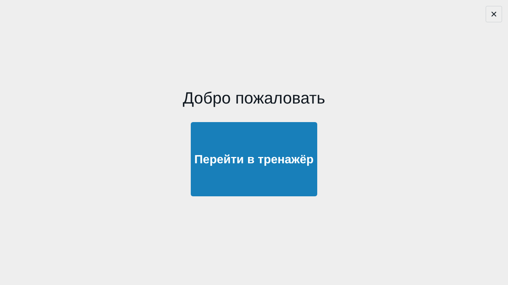

Чтобы выйти, нажмите «Выйти» в шапке. Не оставляйте тренажёр открытым на общем компьютере.

# 3. Экран диспетчера

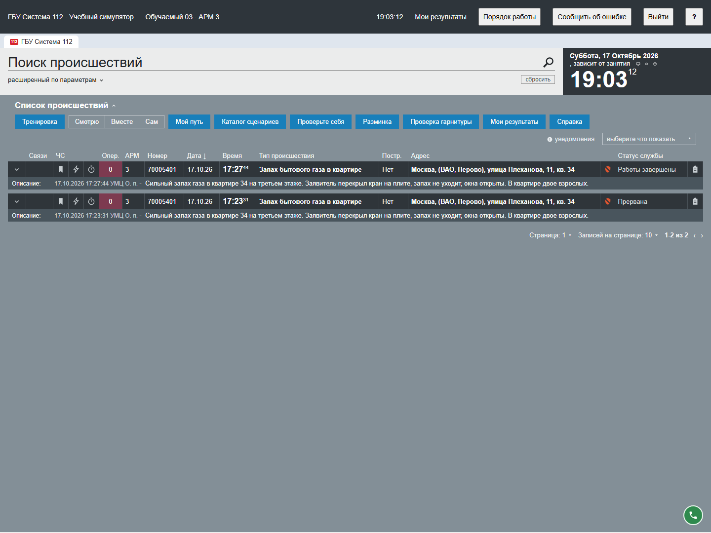

**Шапка.** Слева — ваше имя и номер АРМ, справа — часы и кнопки:

- «Мои результаты» — разбор закрытых карточек;
- «Порядок работы» — порядок действий с карточкой по шагам;
- «Сообщить об ошибке» — отправить замечание администратору, экран подставится сам;
- «Выйти»;
- «?» — объяснение экрана (раздел 10).

**Вкладки.** Первая вкладка «ГБУ Система 112» — список. Каждая карточка в работе открывается своей вкладкой.
Когда приходит новая карточка, звучит сигнал и появляется вкладка.

**Поиск.** В строке «Поиск происшествий» введите номер, тип, адрес или часть описания.
Кнопка «сбросить» возвращает весь список.

**Список происшествий.** Новые карточки — сверху. В строке видны номер, время, тип, признак «Постр.» (пострадавшие), адрес и статус вашей службы.
Стрелка в начале строки раскрывает предпросмотр: службы, заявитель, информация. Карточку она не открывает.

**Над списком** — кнопки обучения и выбор этапа (раздел 9). В «Смотрю» и «Вместе» подсказка появляется рядом с действием, которое нужно выполнить; постоянной правой панели нет.
**Зелёный значок телефона** в правом нижнем углу открывает телефон ДДС (раздел 7).

# 4. Порядок работы с карточкой

Статусы ставятся только по факту: пока бригада не доложила, соответствующий статус поставить нельзя.
Бригада тоже действует только по вашим решениям: без нужного статуса она не докладывает дальше.

| Шаг | Что вы делаете | Статус |
|---|---|---|
| 1. Карточка поступила | Откройте её щелчком по строке или клавишей Enter. Время реакции уже идёт | «Получена службой» (ставится сама) |
| 2. Решение | Прочитайте карточку. Решите, ваша ли она. Не позже 30 секунд | «Принята» или «Не принята» |
| 3. Бригада | Позвоните свободной бригаде и дайте вводную: адрес и что случилось | — |
| 4. Выезд | Выслушайте доклад о выезде, ответьте «Принял», перенесите доклад в комментарий | «Начало реагирования» |
| 5. Прибытие | Бригада позвонит сама. Ответьте и перенесите доклад в комментарий | «Прибытие» |
| 6. Работы | Выслушайте доклад о работах. Если бригада просит другую службу, позвоните в неё | «Проведение работ» |
| 7. Завершение | Выслушайте итог, допишите его в комментарий и поставьте статус | «Работы завершены» или «Отказ от выполнения работ» |

Тот же список открывается кнопкой «Порядок работы» в шапке.

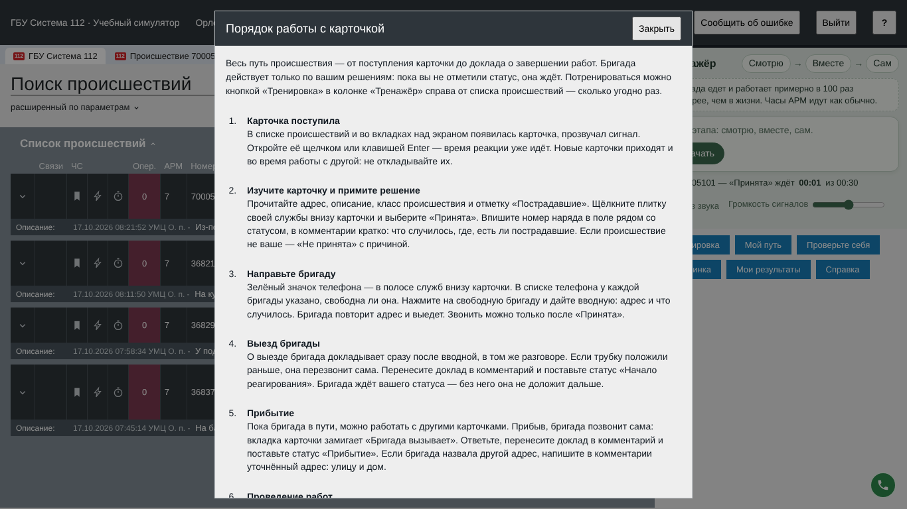

# 5. Карточка и статусы

Щёлкните строку в списке: карточка откроется в отдельной вкладке.

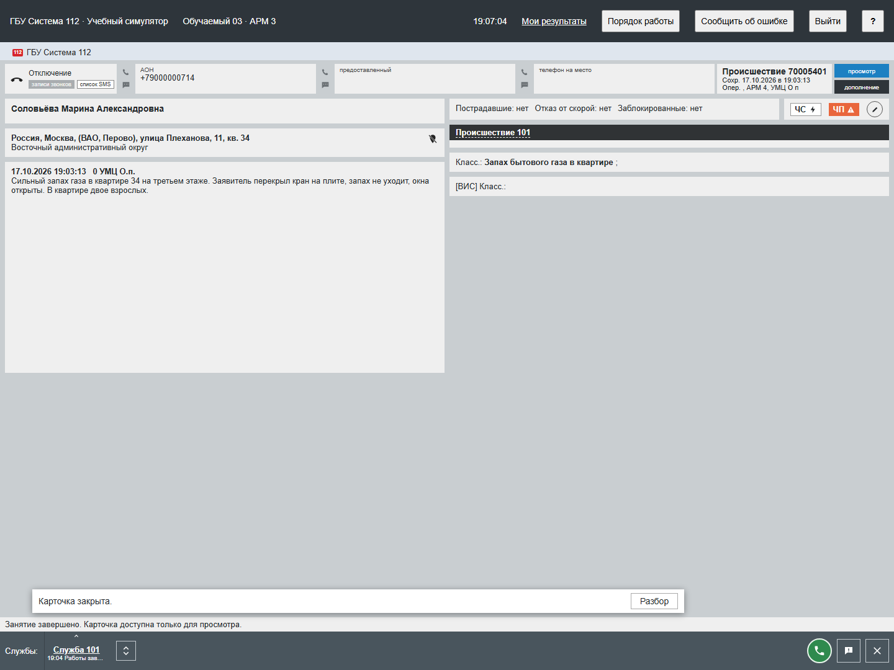

В карточке вы видите телефоны, фамилию заявителя, адрес, описание, признаки («Пострадавшие», «Отказ от скорой», «Заблокированные») и класс происшествия.
Адрес в карточке изменить нельзя. Если бригада назвала другой адрес, напишите уточнённый адрес в комментарий.

Внизу — полоса «Службы:». Ваша служба подчёркнута. На её плитке:

- карандаш открывает строку статуса;
- стрелка вверху плитки открывает историю статусов с временем и комментариями.

Справа в полосе: зелёный значок телефона, «Перенаправить» (только после «Не принята») и ✕ — закрыть карточку.

## Как поставить статус

1. Нажмите карандаш на плитке своей службы. Внизу откроется строка «Статус · Номер наряда · Комментарий».
2. Выберите статус в списке «Статус». Список показывает только допустимые сейчас статусы.
3. Со статусом «Начало реагирования» впишите «Номер наряда» — номер выехавшей бригады (201…).
   На «Принята» бригада ещё не выбрана — поле оставьте пустым: на решение 30 секунд.
4. Напишите «Комментарий».
5. Нажмите ✓ («Подтвердить») или клавишу Enter. Кнопка ✕ закрывает строку без сохранения.

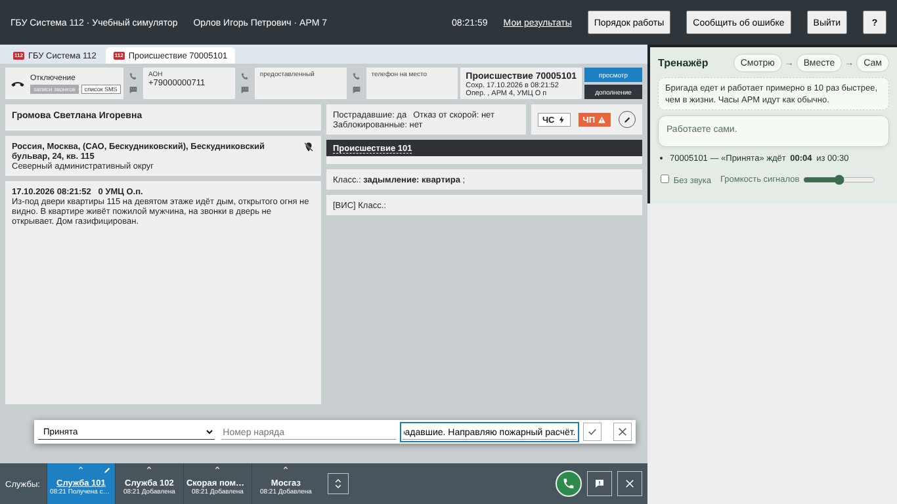

После сохранения на плитке службы появится время и статус.

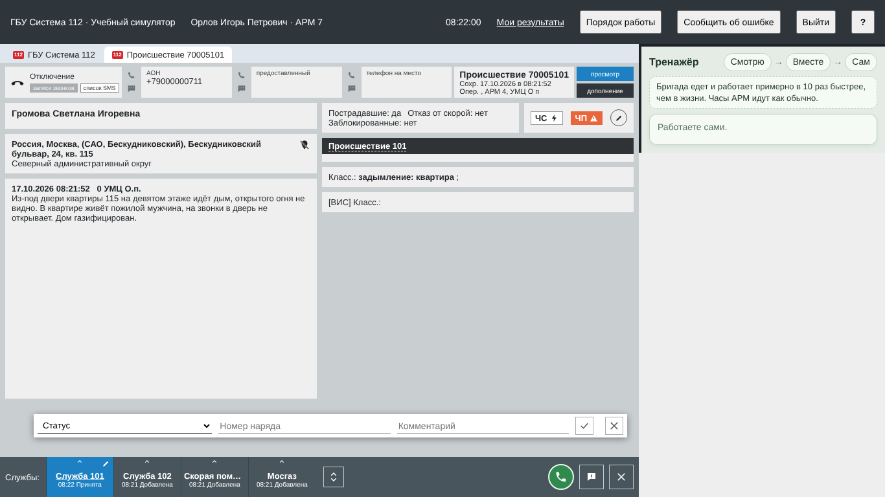

С клавиатуры: Alt+Z открывает строку статуса, Tab переходит между полями, Enter сохраняет, Esc закрывает строку.

## Что писать в комментарии

В комментарии пишите: что случилось, где, какое решение принято, есть ли пострадавшие.
Для «Принята» добавьте, кого направляете. Для «Не принята» и «Отказ от выполнения работ» укажите причину — без неё статус не сохранится.
Перед «Работы завершены» допишите итог работ: после этого статуса карточка закрывается для правок.
Подсказка в пустом поле «Комментарий» меняется вместе со статусом.

В обучении «Вместе» рядом со строкой статуса могут появляться подсказки по комментарию. Они помогают проверить написанное; перед сохранением всё равно прочитайте текст сами. В самостоятельном режиме и на занятии учебного подсказчика нет.

## Особые правила

- **Время.** На «Принята» или «Не принята» отводится 30 секунд с появления карточки. Позже срока время в истории выделяется красным. Первичный статус нужно поставить вовремя даже при нехватке сведений.
- **Не наша карточка.** Поставьте «Не принята» и напишите причину и службу, которой передаёте карточку. После этого станет доступна кнопка «Перенаправить»: выберите службу в поле «Служба для перенаправления», напишите причину в «Комментарий» и нажмите «Подтвердить». Кнопка «Отменить» закрывает форму.
- **Скорая помощь (103).** У этой службы нет статусов «Не принята» и «Отказ от выполнения работ». Если выезда не было, пишите в комментарии «Завершение работ без бригады» и ставьте «Работы завершены».
- **Ошибка в «Принята».** Если вы ошибочно поставили «Не принята», можно поставить «Принята» — это исправление, а не опоздание.

# 6. Несколько карточек сразу

В занятии с параллельной работой карточки приходят, пока вы заняты другой. При первом входе появится окно «Карточки будут приходить параллельно».
Нажмите «Понятно».

Правила простые:

- новую карточку не откладывайте: решите «Принята» или «Не принята» и возвращайтесь к прежней;
- пока бригада едет или работает, занимайтесь другими карточками;
- когда бригада звонит с докладом, вкладка карточки мигает надписью «Бригада вызывает».

Максимум одновременных карточек задаёт преподаватель, но не больше вашего уровня. Над списком постоянно видна строка «Параллельная работа».

# 7. Телефон ДДС

Нажмите зелёный значок телефона. Откроется окно «Телефон». Окно можно перетащить за кнопку со стрелками, изменить его размер за край или угол, свернуть кнопкой «−» и закрыть кнопкой «Закрыть». Кнопка «В центр» возвращает окно на место.

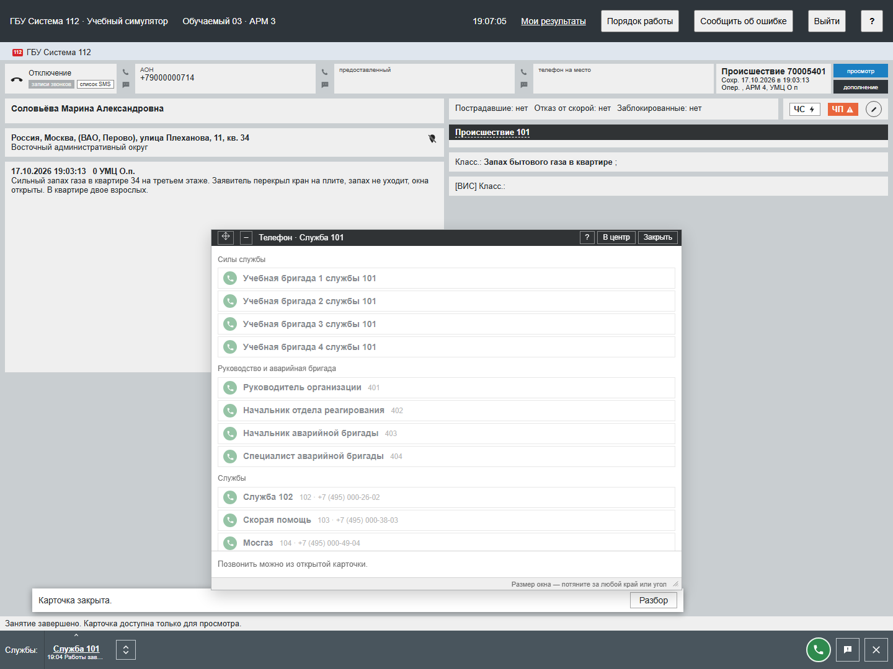

В списке три группы:

- **Силы службы** — бригады вашей ДДС с прямыми номерами (201, 202…). Рядом написано, свободна ли бригада: «свободна», «направлена сюда» или «занята: происшествие N»;
- **Руководство и аварийная бригада** — абоненты, которых добавил преподаватель (руководитель организации, начальник отдела реагирования, начальник и специалист аварийной бригады);
- **Службы** — другие службы и система-112 (номер 112).

Если преподаватель добавил заявителя, он тоже есть в списке: его номер указан в карточке.
С пострадавшим диспетчер не говорит.

Чтобы позвонить, нажмите на абонента или впишите номер в поле «Номер» и нажмите «Позвонить». Бригаде можно звонить только после «Принята»: окно подскажет, если вы поторопились.
Службу можно вызвать коротким номером или полным учебным городским номером из контактов. Оба варианта связывают с виртуальным собеседником внутри тренажёра; реального внешнего звонка нет.

## 7.1. Вводная бригаде

1. Поставьте «Принята».
2. Нажмите на свободную бригаду. Она ответит: «Слушаю вас».
3. Сообщите адрес и что случилось. Есть два способа:
   - «Говорить» — сказать голосом (раздел 7.4);
   - «По частям» — выбрать из коротких вариантов. Шаги — «Адрес», затем «Что случилось». На каждом шаге до трёх вариантов, верный ничем не отмечен.

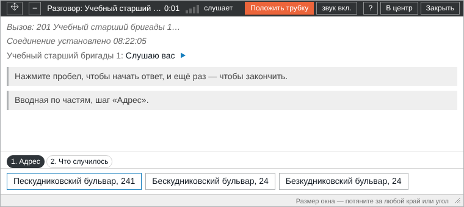

4. Бригада повторит адрес и сообщит о выезде. Доклад звучит голосом и отображается текстом: выслушайте его и подтвердите приём. Пока собеседник говорит, ответ недоступен.

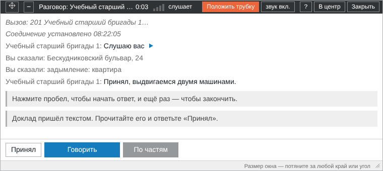

5. Бригада может повторить адрес с ошибкой, например «Бескудниковский переулок» вместо «бульвара». Это ловушка: поправьте её кнопкой «Поправка по адресу: …» или голосом. Если не поправить, бригада поедет не туда, и разбор отметит критическую ошибку.

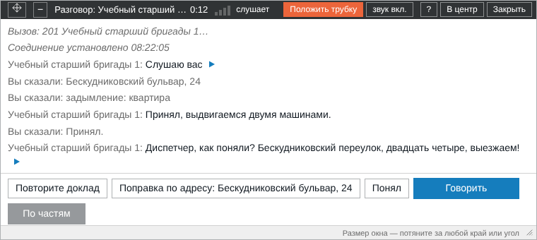

6. Когда разговор закончен, нажмите «Положить трубку». Если вы молчите, бригада может положить трубку сама.
7. После звонка окно показывает итог. «Перезвонить» набирает тот же номер снова, «К контактам» возвращает список.

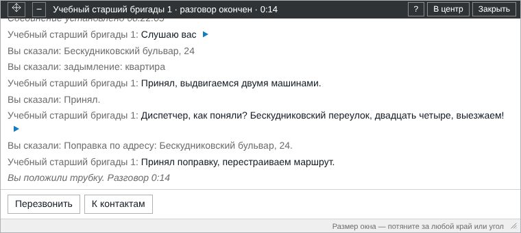

После доклада о выезде перенесите его в комментарий и поставьте «Начало реагирования».

Кнопки ответа бригаде в разговоре: «Принял» подтверждает текстовый доклад, «Повторите доклад» просит бригаду повторить его.
Кнопка «Понял» подтверждает всё, что сказала бригада, в том числе ошибочный адрес. Нажимайте её, только когда в докладе нет ошибки.
Если бригада задаёт вопрос, например на каком этаже квартира, ответьте вариантом, который подтверждается описанием карточки.

## 7.2. Входящие доклады бригады

О прибытии, работах и завершении бригада звонит сама. Звучит сигнал, значок телефона пульсирует и показывает число вызовов, вкладка карточки мигает «Бригада вызывает».

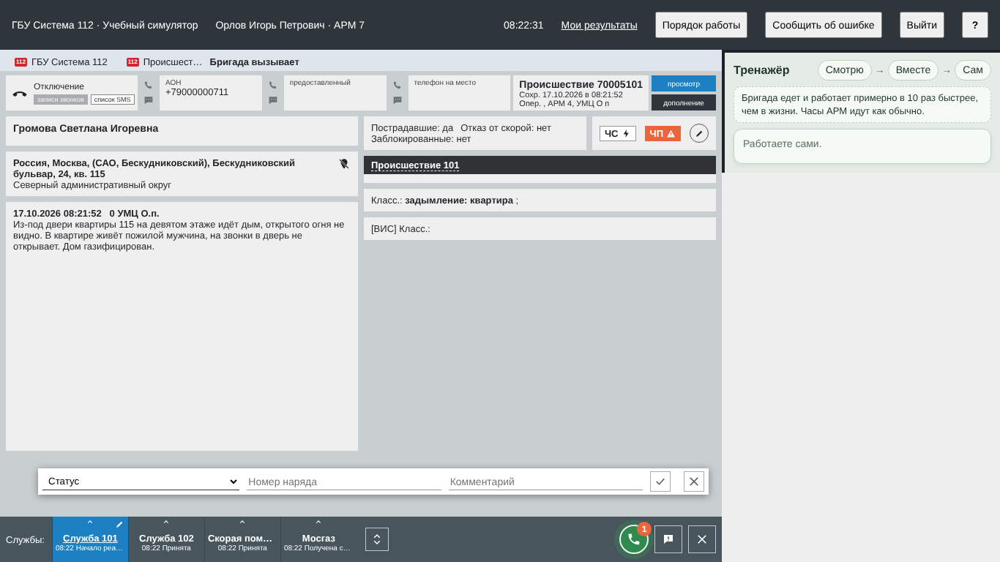

Откройте телефон. В верхней строке написано: «Старший бригады · 201 · входящий вызов · по карточке … · ждёт 0:10». Нажмите «Ответить».

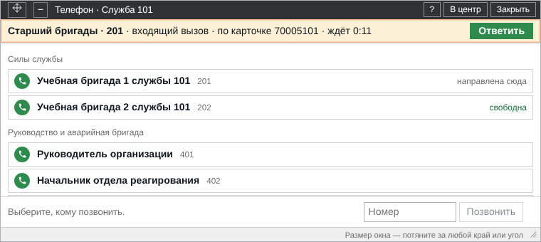

Выслушайте доклад, ответьте «Принял» и поставьте статус по докладу.

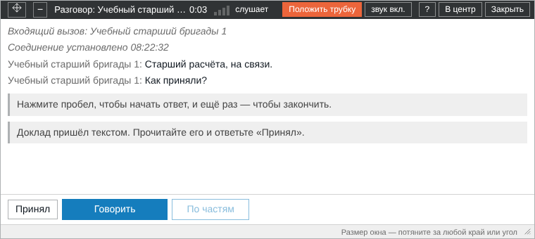

Если вы не ответили, бригада звонит 25 секунд и повторит вызов позже. В окне появится строка «пропущенный вызов» и кнопка «Перезвонить».
Если пропущен и второй вызов, строка изменится на «доклад потерян»: бригада больше не звонит сама, и доклад можно получить, только позвонив ей.

Если вызов пришёл во время разговора, у вас два варианта:

- «Удержать и ответить» — первый разговор встанет на удержание, потом нажмите «Снять с удержания»;
- «Ответить, положив текущий» — первый разговор завершится.

На удержании абонент ждёт не дольше трёх минут.

## 7.3. Доклад службе и руководству

Когда обстановка требует, звоните другой службе или руководству. Например, бригада просит скорую или нужна газовая служба. Для изменения обстановки можно звонить в систему-112 (номер 112).

Сообщите, кто вы, адрес и повод, что изменилось или какая помощь нужна. При звонке в систему-112 дополнительно назовите номер карточки — это требование памятки ДДС (с. 32). В звонке другой службе или руководству номер карточки не является обязательной частью доклада.
Можно сказать сведения одной фразой. Служба переспрашивает одним вопросом то, чего не хватило.

Без микрофона докладывайте по частям: «Кто вы», «Адрес», «Что случилось», «Что изменилось». Шаг «Карточка» добавляется только для звонка в 112.
Номера шагов видны над вариантами. На каждом шаге до трёх вариантов: выбирайте тот, что совпадает с карточкой. Если улица в карточке похожа на другую улицу Москвы, дежурный попросит повторить её по буквам.

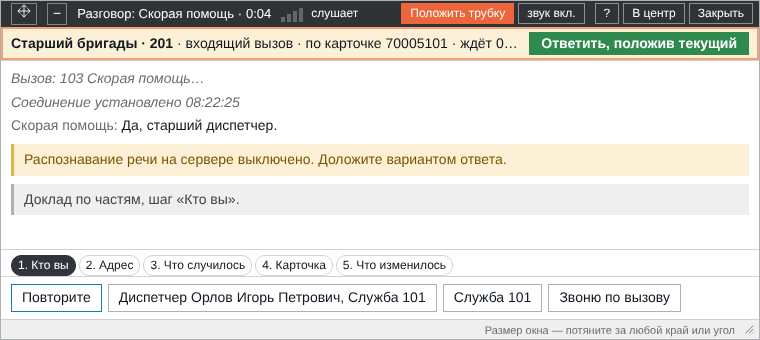

## 7.4. Голос

Нажмите «Говорить», скажите фразу и нажмите «Закончить ответ». С клавиатуры работает удержание: зажмите пробел, произнесите ответ и отпустите — запись закончится. Пробел не перехватывается в поле ввода текста или списке. Пока говорит собеседник, дождитесь конца реплики и начните запись.
Во время записи видна шкала громкости: «тихо», «норма», «громко». Если слышно плохо, говорите ближе к микрофону.

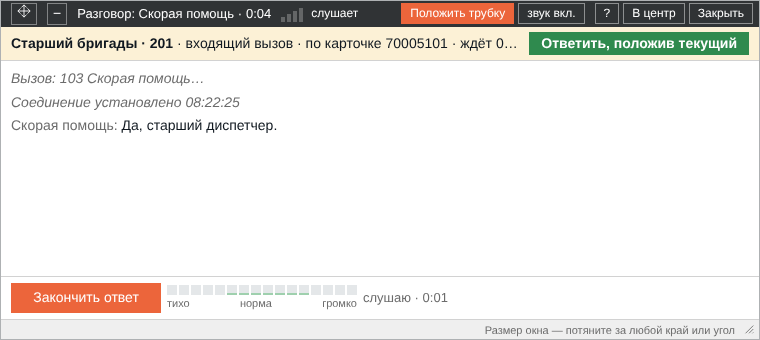

Засчитывается смысл сказанного, а не порядок слов: «сто два» — это 102, «Бескудниковский бульвар двадцать четыре» — это адрес.
Если фраза распознана неуверенно, она появится в поле: проверьте её, поправьте и нажмите «Отправить» или Enter.
«Сказать заново» запишет фразу ещё раз без штрафа, Esc уберёт поле.

Если браузер спросит разрешение на микрофон, разрешите его. Если микрофона нет или распознавание на сервере выключено, окно напишет об этом, например: «Распознавание речи на сервере выключено. Доложите вариантом ответа.»
Тогда пользуйтесь кнопкой «По частям».

Громкость звука в окне выключается кнопкой «звук вкл.».

## 7.5. Звонок заявителю

Позвонить заявителю можно только если преподаватель включил его номер в список телефона. Такие простые бытовые сценарии встречаются: мусор выброшен не там, животное в вентиляционной шахте.
В списке такой абонент называется «Заявитель». Можно также набрать в поле «Номер» телефон заявителя из карточки.

# 8. Особые события

**Тревога бригады.** Преподаватель может подать тревогу по ходу занятия: бригада звонит с сообщением о беде. Ответьте сразу. Позвоните в скорую (103) или в систему-112. Без вызова разбор отметит критическую ошибку.

**Вызов отдела контроля.** Если карточка дольше 60 секунд без статуса «Принята» или «Не принята», звонит отдел контроля реагирования. В окне телефона появится строка «Вызов отдела контроля» с кнопкой «Ответить». Объясните ситуацию голосом или вариантом ответа.

**Услышано по телефону.** В режиме «Вместе» рядом со строкой статуса может появиться подсказка о докладе и кнопка «Подставить». Она подставляет статус, но сохранить его нужно самому. В «Сам», каталоге и занятии преподавателя переносите сведения из разговора самостоятельно.

**Связь с сервером.** При обрыве смотрите сообщение о состоянии связи. Отправленные действия сохраняются в очереди браузера и повторяются после восстановления. Не дублируйте уже отправленное действие; сначала дождитесь обновления карточки.

# 9. Кнопки обучения и каталог

Кнопки находятся над списком происшествий. На первой ступени рядом доступны этапы «Смотрю», «Вместе» и «Сам».

- В «Смотрю» тренажёр показывает действия; «Беру управление» передаёт их вам.
- Во «Вместе» подсказка находится у нужного поля или кнопки и меняется вместе с шагом. Её можно закрыть крестиком или Esc.
- В «Сам», каталоге, на ступенях 2–4 и занятиях преподавателя учебных подсказок нет.
- Время бригад в учебной смене сжато; часы АРМ идут как обычно. Не ждите подсказки для первичного решения: норматив реакции остаётся 30 секунд.

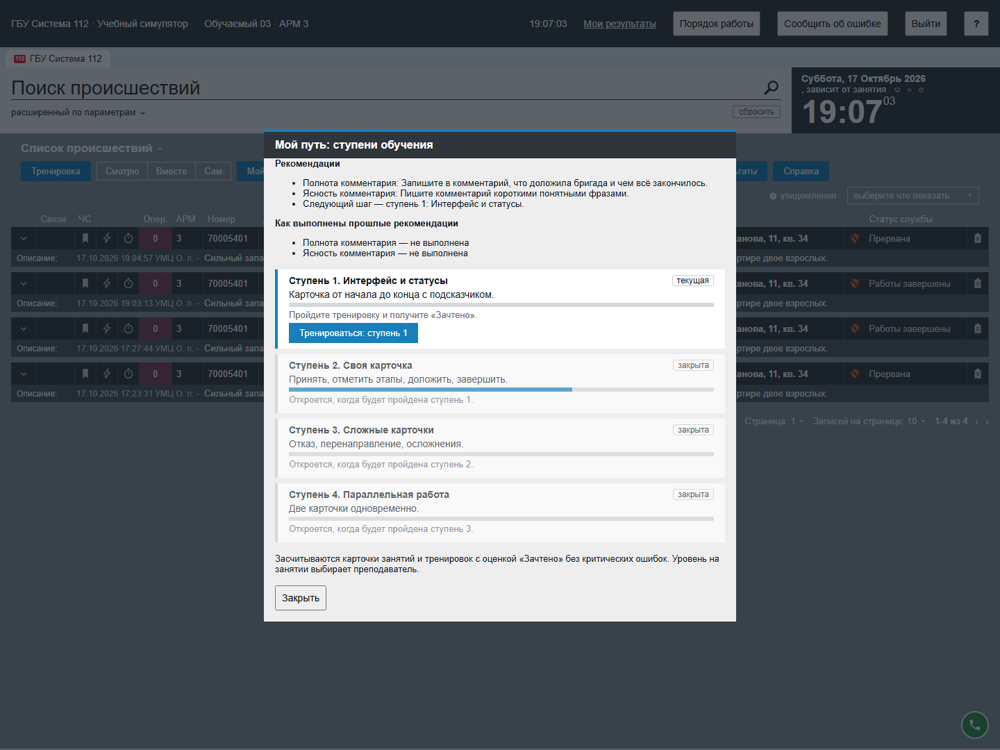

Под зоной — кнопки обучения, «Проверьте себя» — в окне «Порядок работы» вверху справа.

| Кнопка | Что делает |
|---|---|
| «Тренировка» | Выдаёт учебную карточку. Этапы «Смотрю → Вместе → Сам»: на первом тренажёр сам проходит карточку и говорит, что делает; на втором то же делаете вы с подсказками; на третьем вы работаете сами |
| Портрет Николая Сергеевича | «Тренировка с Николаем Сергеевичем» на любой ступени: выбор «Смотрю», «Вместе» или «Сам» на учебной карточке. Ступень 1 засчитывается, когда карточка во «Вместе» или «Сам» получила «Зачтено»; «Смотрю» — показ, он не засчитывается. Здесь же галочка «Николай Сергеевич в подсказках» |
| «Мой путь» | Четыре ступени обучения: «Интерфейс и статусы», «Своя карточка», «Сложные карточки», «Параллельная работа». Ступень засчитывается, когда карточки получили оценку «Зачтено» без критических ошибок |
| «Каталог сценариев» | Проработанные сюжеты по службам: ваша служба показана первой. Прочитайте описание, уровень и тренируемые навыки, затем нажмите «Пройти». Вы будете диспетчером службы выбранного сюжета; подсказчика нет, оценка как на занятии |
| «Проверка гарнитуры» | «Проверить наушники» проигрывает тон слева и справа; «Проверить микрофон» записывает указанную фразу. При включённом распознавании видно, что услышал сервер; иначе проверяется запись звука, без расшифровки |
| «Проверьте себя» (в окне «Порядок работы») | Пять вопросов по памятке ДДС. Нажмите «Проверить», чтобы увидеть результат |
| «Разминка» | Упражнения на один навык по две минуты: «Найди отличие в адресе» и «Кого направить». Ошибки возвращаются первыми в следующий раз |
| «Мои результаты» | Разбор закрытых карточек |
| «Справка» | Учебные материалы, назначенные преподавателем, и порядок работы |

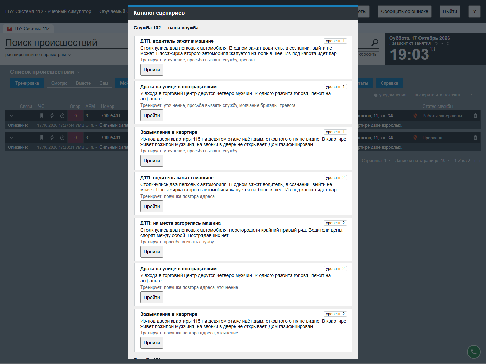

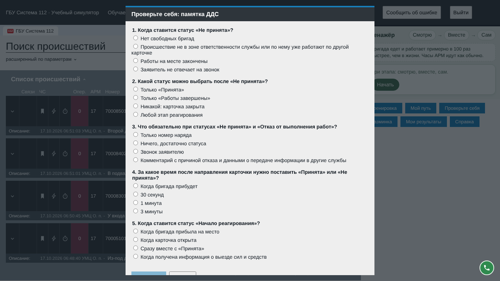

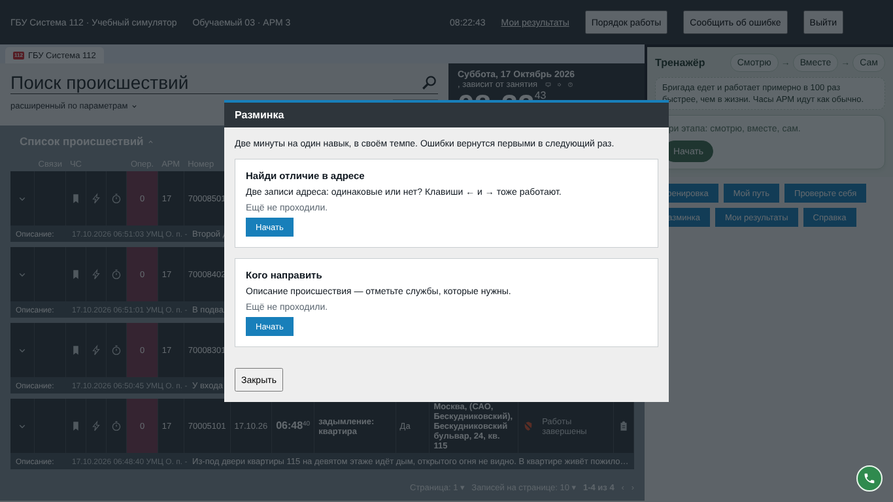

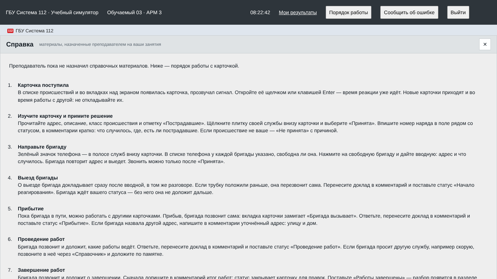

# 10. Подсказки по интерфейсу

Нажмите «?» в шапке. Части экрана обведутся и получат номера. Нажмите «Далее» и «Назад» или наведите мышь на номер: рядом появится пояснение, что это и как с ним работать.
Esc закрывает подсказку. Пока она открыта, нажатия не доходят до экрана, но время по карточке идёт.

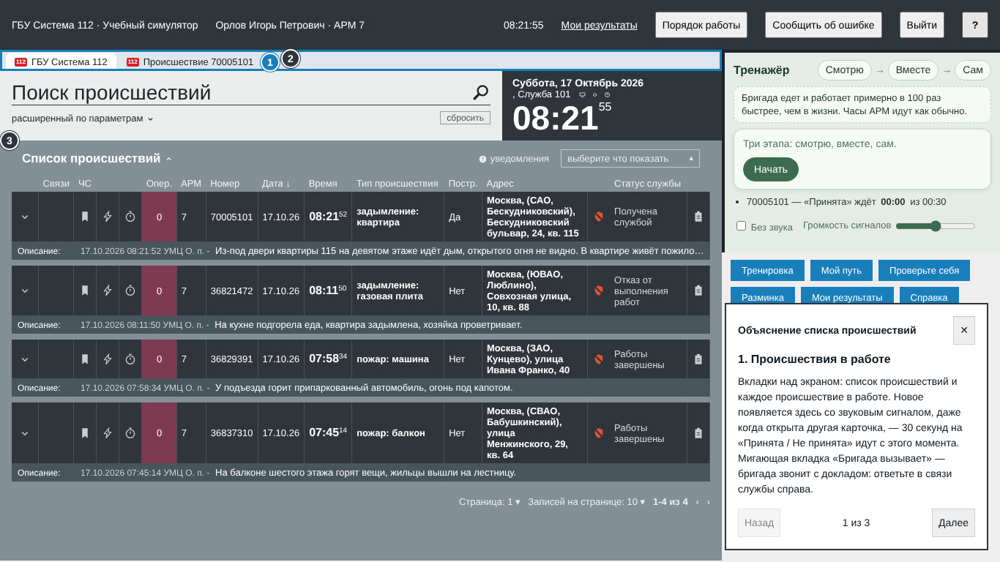

Подсказки есть у списка, карточки, окна результатов, справки и окна телефона (кнопка «?» в его шапке). Если вы освоили окно, часть пояснений скрывается сама.
На экране без подсказки кнопки «?» нет.

Кнопка «Порядок работы» показывает шаги из раздела 4. «Сообщить об ошибке» отправляет замечание администратору.

# 11. Результаты и рекомендации

Нажмите «Мои результаты». Слева — закрытые карточки, сгруппированные по занятиям. Справа — разбор выбранной.

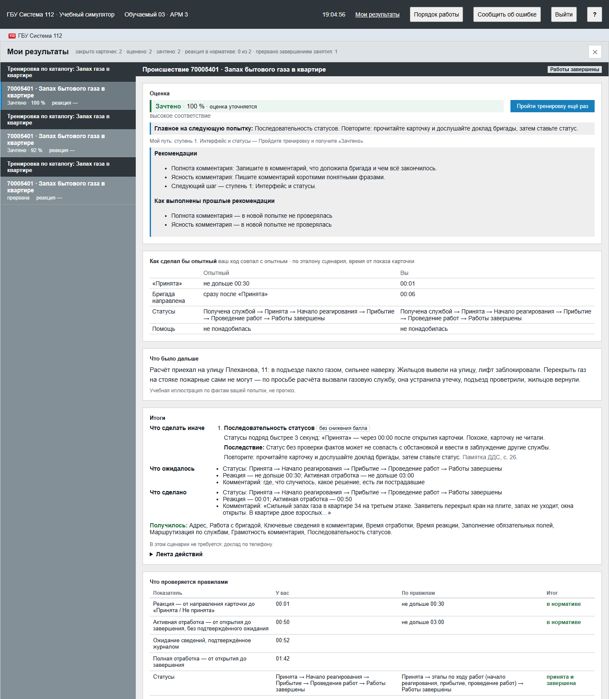

В верхней части:

- «Оценка» — процент и «Зачтено» или «Не зачтено», когда полный разбор готов либо преподаватель принял решение. Пока проверка текста идёт, виден предварительный балл и причина ожидания, но зачёт не объявляется;
- «Главное на следующую попытку» — что тренировать в первую очередь;
- ступень «Мой путь», которую вы сейчас проходите.

Ниже:

- «Что сделать иначе» — замечания по порядку важности;
- «Что ожидалось» и «Что сделано» — эталонный ход и ваш ход рядом;
- «Получилось» — критерии, где вы всё сделали верно;
- «Хронология» и таблица «Что проверяется правилами» — время и баллы по каждому критерию.

Если время измерено по неподтверждённым часам, рядом написано «норматив не проверен,
штрафа нет». Такой результат не считается ни нарушением, ни выполненным нормативом.

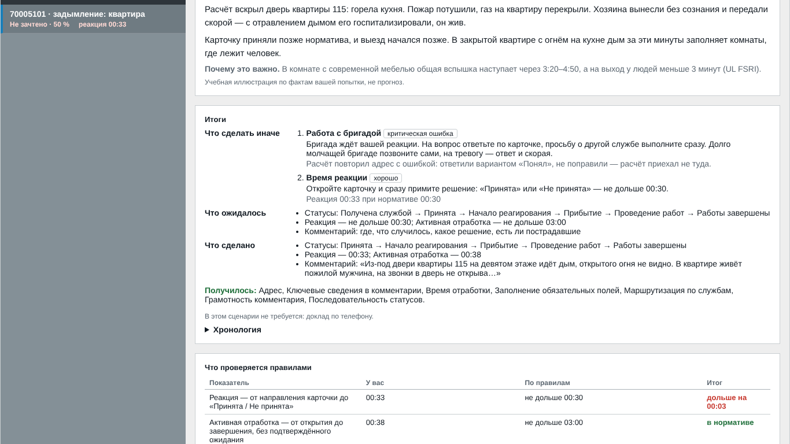

Оцениваются: время реакции, время отработки, последовательность статусов, маршрутизация по службам, заполнение обязательных полей, адрес, доклад по телефону, грамотность комментария, ключевые сведения в комментарии и работа с бригадой.
Критическая ошибка, например неисправленный адрес бригады, ограничивает итоговый балл.

Преподаватель видит те же данные, а по итогам занятия предлагает следующий уровень сложности. Продолжайте с кнопки «Мой путь». Для новой попытки того же завершённого тренировочного сценария нажмите «Пройти тренировку ещё раз» в разборе: прежняя попытка сохраняется, а новая начинается заново с исходными данными сценария. В разборе может появиться «Что было дальше» — учебный итог по действиям этой попытки, а не прогноз реального происшествия.

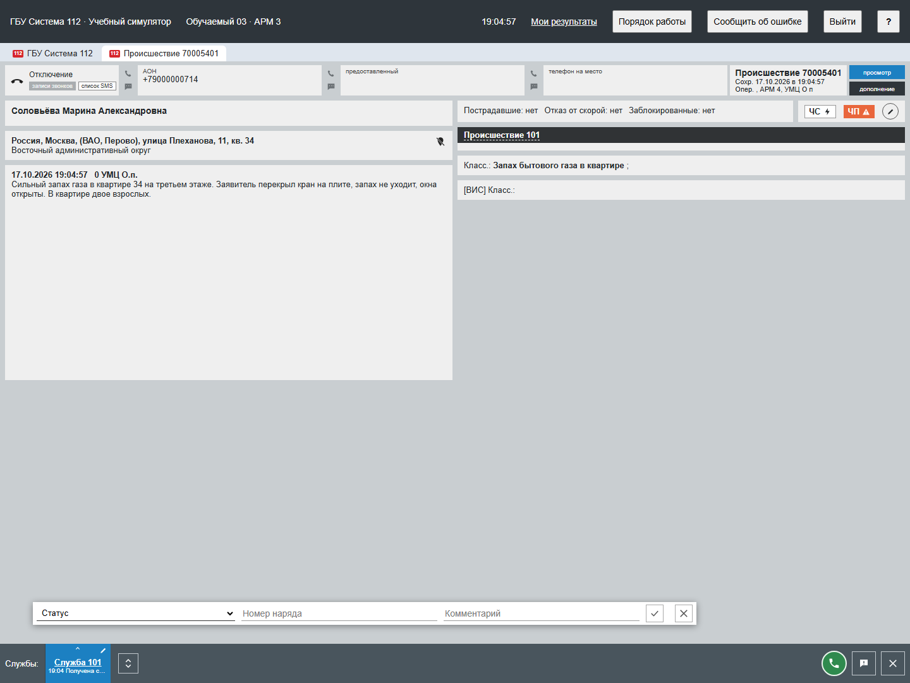

# 12. Если что-то не получается

| Что случилось | Что делать |
|---|---|
| Телефон не звонит бригаде | Сначала поставьте «Принята». Выберите свободную бригаду: у занятой написано «занята: происшествие N» |
| Статус не сохраняется | Проверьте, что выбран допустимый статус, написан комментарий, а для отказа — причина. Статус по докладу доступен только после самого доклада |
| Нет кнопки «Не принята» | У службы 103 такого статуса нет (раздел 5) |
| Нет кнопки «Перенаправить» | Она появляется только после «Не принята» |
| «Говорить» не слышит | Разрешите микрофон в браузере или докладывайте по частям |
| Бригада поехала не туда | Вы не поправили адрес при повторе. В следующий раз нажмите «Поправка по адресу» |
| Пропустили вызов бригады | Нажмите «Перезвонить» в строке «пропущенный вызов» |
| Страница не отвечает | Обновите страницу. Введённые действия сохраняются и отправляются повторно |

Если проблему решить не удалось, нажмите «Сообщить об ошибке» или обратитесь к преподавателю.
